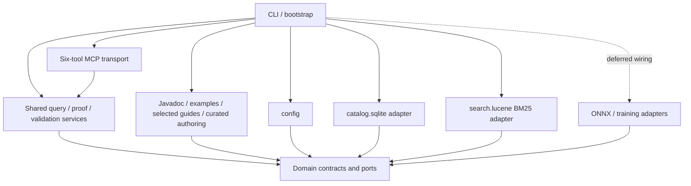
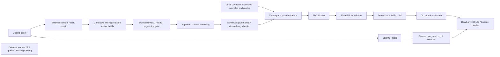
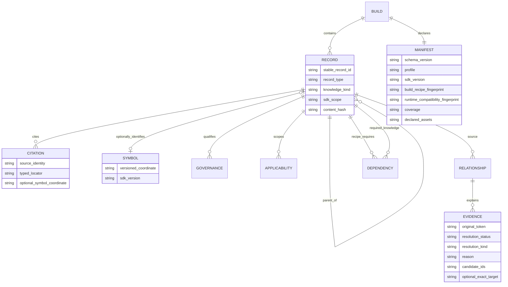

# Architecture Spine — LuciadLightspeed Knowledge MCP

## System Structure

Planning amendment applied 2026-10-02 under the [approved change](../../../initiative-luciad-mcp/change-evidence-backed-first-proof/change-evidence-backed-first-proof.md). This is prospective design, not an implementation or schema-approval claim. Story 2.5 review remains the active-delivery gate. Historical briefs are superseded where conflicting; existing scaffolds remain in place.

One Java 21/Gradle process uses domain-owned ports with embedded SQLite and Lucene. Shared query/proof/validation services serve both CLI diagnostics and MCP. Source modules retain their established names; no new runtime/database is introduced. `packaging` is a deployment concern rather than a Java module.



Solid arrows are compile-time dependencies; CLI/bootstrap constructs and injects concrete adapters into domain ports. Services/ingestion have no direct engine dependency. Dashed deferred wiring is not part of first-proof startup.

## Invariants & Rules

### AD-1 — Dependencies point inward through domain ports

**Rule (approved planning amendment, 2026-10-02):** Domain owns plain immutable contracts, identity recipes and ports, with no framework/database/I/O dependency. Shared application services use domain ports; CLI/bootstrap wires concrete SQLite/Lucene adapters. MCP/retrieval never import ingestion/parsers or engine implementations; no cycles. Distinguish runtime wiring from compile-time dependencies in the graph.

### AD-2 — Embedded engines only; single internal-host listener `[ADOPTED]`
- **Binds:** catalog.sqlite, search.lucene, embeddings.onnx, mcp
- **Prevents:** anyone introducing an external database, search server, model server, or a second network service.
- **Rule:** SQLite and Lucene run in-process as libraries; ONNX remains an in-process option only if deferred vectors are reactivated. The only listening socket is the MCP Streamable HTTP transport, bound to the internal host interface reachable by the trusted team (v1); it is never exposed to the public internet. No component opens any other server socket or connects to an external data/model service. *(Amended 2026-08-24 — v1 bind widened from loopback to the shared internal host to serve a small trusted team; the zero-external-egress guarantee is unchanged.)*

### AD-3 — Versioned symbols and stable record IDs have distinct roles

**Rule (approved planning amendment, 2026-10-02):** Use one domain-owned versioned symbol coordinate (SDK/product, version, language, namespace, owner, member, parameters, element kind) for API identity and references. Content records, including symbol-less records, have stable record IDs. Normalized aliases aid lookup, never define alternate identities; tags never define identity. Story 2.8 freezes serialization and known answers.

### AD-4 — Two-pass ingestion; never fabricate `[ADOPTED]`
- **Binds:** ingest.javadoc, ingest.examples, ingest.guides, catalog.sqlite
- **Prevents:** forward-reference races; guessed/hallucinated symbols entering the catalog.
- **Rule:** Pass 1 builds the full symbol catalog. Pass 2 resolves relationships, cross-references, and example/workflow/guide links against the completed catalog. A reference that does not resolve to a catalog symbol is recorded as explicitly unresolved — never invented, never silently dropped.

### AD-5 — Immutable index builds; validate-then-atomic-activate `[ADOPTED]`
- **Binds:** catalog.sqlite, search.lucene, cli, mcp
- **Prevents:** two writers on a live index; torn reads; serving a half-built index.
- **Rule:** Each build writes to a new immutable directory keyed by `{sdkVersion}/{buildId}`. It is validated before activation. Activation is an atomic swap of the active-index pointer. The serving process opens indexes read-only and never mutates an active index; rollback is re-pointing to a prior build.

### AD-6 — Capability-specific compatibility on every load

**Rule (approved planning amendment, 2026-10-02):** The manifest declares schema, SDK/build, symbol/identity formats, Lucene compatibility and selected capabilities. Lexical is primary and explicitly needs no model. Common contracts and all declared assets must match runtime; unknown schemas/profiles or corrupt data reject the build. Model/dimension/tokenizer/preprocessing fields apply only to a later approved vector profile. One BuildValidator applies this policy everywhere (AD-33).

### AD-7 — Exact evidence cannot be replaced by relevance

**Rule (approved planning amendment, 2026-10-02):** After SDK/build binding, resolve and check symbols against catalog facts. Exact proof ranks ahead of lexical candidates; relevance never proves identity or applicability. Unknown remains unknown; ambiguous overloads are never silently selected. Six-tool consumers use these same services.

### AD-7a — Bind one SDK version before every query

**Rule (approved planning amendment, 2026-10-02):** Explicit caller SDK version or configured default binds before lookup. A symbol only in another version is unknown in the target version. First-proof cross-version migration/combined scopes return unsupported-operation; no opt-in can silently combine versions. A request pins one immutable build handle.

### AD-8 — Identical embedding fingerprint at index-time and query-time `[DEFERRED]`

**Disposition:** Deferred design retained for provenance and future review. It is not an active first-proof capability or exception; reactivation needs measured benefit and owner approval.
- **Binds:** embeddings.onnx, ingest.*, retrieval
- **Prevents:** index/query embedding-space mismatch producing silently wrong similarity.
- **Rule:** The same model, tokenizer, text preprocessing, normalization, output dimension, and any query/passage prefix convention are used when building vectors and when embedding queries. These parameters are sourced from one shared configuration and recorded in the manifest fingerprint (AD-6).

### AD-9 — Zero external egress on all active paths

**Rule (approved planning amendment, 2026-10-02):** Every active first-proof ingest and serve path makes zero DNS/HTTP/telemetry/model-download/update-check calls. Inputs and dependencies are local/offline. AD-28 is a deferred historical design, not an active network exception. Shared inbound internal-host access never authorizes outbound access.

### AD-10 — Parse-only knowledge service; external compile/test

**Rule (approved planning amendment, 2026-10-02):** JSoup and JavaParser inspect HTML/source statically without SDK JAR/class-file symbol solving. Do not compile samples/generated applications, invoke their Maven/Gradle build or execute them. External evaluation/agent environments own compile/test. AD-28 cannot activate a Python/network exception in this proof.

### AD-11 — Bound requests, internal work and responses

**Rule (approved planning amendment, 2026-10-02):** All six tools enforce default page 10, hard cap 50, ≤1 MiB serialized payload, plus finite input/query/candidate/ID-batch/symbol-batch/traversal/trace/time budgets frozen under 2.8. Full content only through bounded get_record sections/continuation or explicit size error. Limits apply before materializing unbounded intermediate sets; return work and payload truncation honestly.

### AD-12 — SDK and build scope are mandatory

**Rule (approved planning amendment, 2026-10-02):** Records, edges, index content and queries carry SDK scope. Bind one explicit/default version and immutable build per request and cursor. Side-by-side builds stay isolated; migration/combined queries are unsupported in the first proof.

### AD-13 — Bounded concurrent stateless serving

**Rule (approved planning amendment, 2026-10-02):** Read-only handlers are stateless per request over a pinned immutable build, with bounded queues and at least four concurrent requests as the unchanged NFR-3 target. No serving request mutates build state. The ONNX thread-safe bounded session-pool design is deferred with vectors, not a lexical dependency.

### AD-14 — Governance is explicit input

**Rule (approved planning amendment, 2026-10-02):** Quality/provenance comes from governed inputs, never filenames/parser inference. Practices require approval state, owner and SDK applicability; candidates and invalid approvals cannot activate. Vendor guide facts may be cited without an invented quality label, while guide-derived practices need separate approval. Recipes validate required dependencies/applicability. Training governance and broad tag vocabulary remain deferred.

### AD-15 — Typed citations on all primary content

**Rule (approved planning amendment, 2026-10-02):** Require stable record ID, source identity, SDK scope, record type and truthful typed locator: HTML page/anchor, source range, curated document/section and later deck/slide. Never fabricate anchors; canonical symbol is optional when unresolved/absent. Fully cited symbol-less content is servable. Verdicts are never dropped for absent content citations (AD-24). The 2026-08-21 conditional-symbol correction is retained.

### AD-16 — Single-file config; redacted logging
- **Binds:** config, mcp, all modules that log
- **Prevents:** leaking proprietary corpus content into logs; hidden runtime inputs.
- **Rule:** `application.yaml` is the sole runtime configuration input. Logs never emit full document bodies or source text by default (redaction). Active retrieval mode, active embedding model, and active index identity are observable only through the `index_status` tool / structured logs — not by dumping content.

### AD-17 — One coordinator and portable build recipe

**Rule (approved planning amendment, 2026-10-02):** cli ingest alone creates staging/build identity and seals the manifest once. It hashes source content, governance inputs, selected profile and versioned build recipe; absolute host roots/output locations do not affect identity. Domain defines BuildContext/manifest semantics; adapters contribute required capability fields exactly once through ports. Absent capabilities are explicit; reports/checkpoints are versioned. Distinguish build recipe from runtime compatibility.

### AD-18 — Stable record IDs join content; symbols link APIs

**Rule (approved planning amendment, 2026-10-02):** Catalog/index/content joins and deduplication use domain-owned stable record IDs. Symbol-less cited records participate normally. API references use the one versioned symbol coordinate and serialization from 2.8. Normalized aliases are lookup aids, never replacement identities. Do not require a canonical symbol to join a content candidate or use tags as identity.

### AD-19 — Bounded retrieval pipeline and truthful counts

**Rule (approved planning amendment, 2026-10-02):** Bind SDK/build → retrieve exact/lexical candidates within finite budgets → governance/applicability and primary-content citation checks → deterministic ordering → bounded page/enrichment. Retrieval owns bounded work/result assembly; transport cannot request a full unbounded candidate set. Return exact/lower-bound/unknown count relation plus work/payload truncation and continuation. Bounded ranked results never claim corpus exhaustiveness. Verdict/status paths bypass content-citation filtering; optional diagnostic provenance is distinct.

### AD-20 — Deterministic ordering and continuation

**Rule (approved planning amendment, 2026-10-02):** Exact-proof tier precedes ranked candidates, then declared deterministic score/order, then stable record ID ascending. Filter-only browse orders by stable ID. Identical logical build/query/config yields identical logical order, independent of thread/iteration/wall-clock. Cursors bind build/version/query; stale scope is rejected or explicitly restarted, never mixed.

### AD-21 — Text preprocessing lives once, behind the Embedder interface

**Disposition:** Deferred design retained for provenance and future review. It is not an active first-proof capability or exception; reactivation needs measured benefit and owner approval.
- **Binds:** embeddings.onnx, ingest.javadoc, ingest.examples, retrieval
- **Prevents:** index-time and query-time preprocessing implemented separately by each caller, both stamping the same config version yet silently diverging (adversarial review H6, defeats AD-8).
- **Rule:** All text preprocessing, tokenization, normalization, and query/passage prefixing are implemented solely inside `embeddings.onnx` behind the `Embedder` interface. That interface accepts raw text plus a role (`QUERY` | `PASSAGE`) and returns the vector; no other module preprocesses text destined for embedding. The `text-preprocessing version` in the AD-6 fingerprint is owned and stamped by `embeddings.onnx` from its own code version, not from config alone.

### AD-22 — Domain owns identity; storage enforces uniqueness

**Rule (approved planning amendment, 2026-10-02):** Domain defines pure versioned symbol/record/edge identity recipes. SQLite invokes them at persistence and enforces uniqueness; ingesters submit logical records/edges through domain ports. Engine row/document IDs, absolute paths and output roots never define identity. Story 2.8 specifies every evidence field effect on identity separately from content hashes.

### AD-23 — Validate handles before atomic publication

**Rule (approved planning amendment, 2026-10-02):** CLI alone owns active-pointer mutation via fully-written temporary pointer and atomic rename, with competing-writer coordination. Server validates a new immutable handle before publishing it; each request pins exactly one build. Invalid replacement leaves a valid current build serving; invalid cold start fails clearly. Retention/GC never removes referenced data. Freeze locking, observation and interruption/recovery behavior in 2.8; implement in 6.x.

### AD-24 — Six tools distinguish content from verdicts

**Rule (approved planning amendment, 2026-10-02):** Primary content tools are search_knowledge, get_record and get_relationships: typed citations are required on content. resolve_symbol, check_symbols and index_status return verdict/status, never suppressed for absent citations. Optional diagnostic source evidence is distinct from required content citation. Exact/ambiguous/unknown verdicts remain visible; absent/not-applicable differs from missing required content evidence.

### AD-25 — Checkpointed ingestion writes to build-scoped staging only
- **Binds:** cli, ingest.javadoc, ingest.examples, embeddings.onnx
- **Prevents:** resume/checkpoint support for large-corpus embedding (brief) being read as license to mutate a partially-built directory in place, which would collide with AD-5's immutable-build guarantee and AD-17's single-seal rule.
- **Rule:** Checkpoints are written only inside the coordinator-owned `BuildContext` staging area (AD-17) for the in-progress `{sdkVersion}/{buildId}`, never to an already-sealed build directory. A resumed run re-attaches to the same `buildId`'s staging area (matched by its sealed input digest) and continues; if the input set changed, it is a new `buildId`, not a resume. Checkpoint state is invisible to `serve` — only a validated, activated build is ever observable (AD-5, AD-6).

### AD-26 — Lexical is healthy primary operation

**Rule (approved planning amendment, 2026-10-02):** Exact/BM25 first-proof operation requires no embedding model and reports healthy lexical capability in index_status. Future vector/model load failures must be explicit; no silent fallback. A configured, explicitly reported fallback policy belongs to deferred vector scope, not to lexical startup.

### AD-27 — Container baseline posture is a build/packaging invariant `[ADOPTED]`
- **Binds:** packaging, cli
- **Prevents:** the operational/security envelope (NFR-12, FR-32) being left to each deployment's discretion instead of being fixed in the shipped artifact.
- **Rule:** The shipped container runs as a non-root user, mounts the root filesystem read-only where practical, drops Linux capabilities, sets `no-new-privileges:true`, and mounts proprietary corpus/model inputs read-only. These are standard container-hygiene defaults for an internal deployment, not a hardened public-facing appliance. Ingestion and serving remain separable one-shot vs. long-running invocations of the same image (brief §14) — never fused into one always-mutable process.
- **Amendment (2026-08-21, Sprint Change Proposal):** This image is the *serving image*. It runs `ingest` (for the four offline record types: Javadoc, examples, workflows, guides), `validate-index`, and `serve`. It never contains docling, Python, or any network-capable tooling. Historical training-material design (AD-28), now deferred, would ship and run from a distinct, ingest-time-only image that is never deployed as, or alongside, the serving image.
- **Amendment (2026-08-24):** v1 serves a small trusted internal team from a shared internal host — the "hardened appliance" framing and the loopback bind are dropped; the container-hygiene defaults above are retained. True hardening (authentication, TLS, tenant isolation) belongs to a future deployment profile, not v1.

### AD-28 — Training-material ingestion is a scoped, explicit exception to AD-9/AD-10 `[DEFERRED]`

**Disposition:** Deferred design retained for provenance and future review. It is not an active first-proof capability or exception; reactivation needs measured benefit and owner approval.
- **Binds:** cli, ingest.trainings
- **Prevents:** the docling-based training-deck exception being read as a general relaxation of the zero-egress (AD-9) or parse-only (AD-10) invariants for any other module, input type, or the serving appliance.
- **Rule:** `ingest.trainings` is the sole module permitted network access (to fetch/run docling's vision-layout models) and the sole module permitted to shell out to non-Java tooling (Python/docling), and only when invoked via `cli ingest` against the local training-materials directory (FR-1's sixth permitted path). This exception is confined to `ingest.trainings`; every other module remains bound by AD-9 and AD-10 unchanged. `ingest.trainings` is built, packaged, and shipped as a separate, ingest-time-only container image (AD-27 amendment) — it is never present in, or reachable from, the hardened serving image that runs `cli serve`. The served MCP appliance (Epic 8, NFR-11) remains fully air-gapped and zero-egress; only the offline `cli ingest` step for training decks gains network access, and only inside that separate image. Docling's parsed output (section titles, ordered text blocks, extracted tables/figures) is submitted to `catalog.sqlite` through the same `CatalogStore`/two-pass discipline as every other record type (AD-4, AD-22) — the exception is scoped to *how the input is read*, never to *how it is cataloged, linked, or served*. Docling's extracted output is frozen as the source-of-record ingestion input; downstream record IDs and content hashes are computed deterministically from that frozen output (NFR-13, AD-22), never by re-running docling's network-fetched, unpinned vision model.

### AD-29 — Technique vocabulary is deferred metadata

**Rule (approved planning amendment, 2026-10-02):** Broad tags and search_concepts are deferred. If later approved, tags remain governance-supplied grouping/filter attributes, never record or symbol identity. Symbol-less cited records are already searchable/fetchable through common tools using stable IDs, without a tag vocabulary.

### AD-30 — Structure-aware example ingestion: refined usage edges, evidence-bearing resolution, bounded graph scope `[ADOPTED]`
- **Binds:** domain, ingest.examples, catalog.sqlite, search.lucene, retrieval
- **Prevents:** (a) the single coarse `EXAMPLE_USES` edge being too weak to answer method-sized conceptual queries; (b) heuristic example resolution silently manufacturing verified Luciad symbols; (c) richer example analysis expanding into an IDE/second-graph-platform.
- **Rule:** Java examples are parsed with JavaParser after a deterministic in-corpus pre-scan (packages, imports, declared types, constructors, methods, local source roots). The ingester emits example-, class-, and method-level records; the complete source is preserved once and child records carry a `SourceRange` plus the minimum text needed for search and citation. Example→symbol relationships use three edge types that REPLACE the former coarse `EXAMPLE_USES`: `USES_TYPE` (resolved Luciad type), `CONSTRUCTS` (resolved Luciad constructor/type), `CALLS` (resolved Luciad method; also a local helper method only when it is part of the Luciad usage sequence). Resolution runs in a fixed ladder — FQN literal → explicit import + exact catalog match → local/same-package declaration → unique wildcard-import match → owner+name+signature/arity match → ambiguous/unresolved — and every derived edge carries evidence (source range, original token, candidate canonical symbols, and the selected symbol only when status is `EXACT`). Only an exact match to the version-scoped catalog is ever returned as a verified Luciad symbol (consistent with AD-4, AD-7). Deferred until retrieval evaluation shows need: field read/write edges, control-flow, data-flow, full CPG. Storage stays SQLite (canonical example/class/method rows + typed edges); Lucene indexes method-sized projections. No LSP, graph server, SDK JAR, sample compilation, or execution is introduced (AD-10 unchanged). Cross-build incremental indexing is deferred until full-build correctness is measured.
- **History and forward contract:** The 2026-08-25 amendment expanded the SDK/example/workflow family from 15 to 17. Preserve structure-aware examples after 2.8: 13 Javadoc + one workflow + three example types. Arity uniqueness alone is insufficient proof when parameter types cannot resolve. Stable identity, source/content hashes, build recipe and runtime compatibility are separate definitions frozen in 2.8; completed Story 1.4 history is unchanged.

### AD-31 — Knowledge trust boundary

**Rule:** record type and knowledge kind are independent; curated authoring compiles to canonical storage; candidates cannot enter active builds; approved practices and recipes satisfy governance/applicability/dependencies. Version dependency types separately from the 17 SDK relations.

**Binds:** FR-45. Planning approval does not close the separate implementation/technical sign-off gates.

### AD-32 — Contract and verification freeze

**Rule:** 2.8 owns schema, symbol serialization, IDs/hashes, ingestion-report, recipe/runtime fingerprint, request/result/error/continuation and finite-bound contracts before dependent work. Breaking changes version or record a reviewed exemption.

**Binds:** FR-44/49. Planning approval does not close the separate implementation/technical sign-off gates.

### AD-33 — Single build-validation policy

**Rule:** every validation, activation, startup, reload, rollback and restore path calls the same service. Explicit ambiguity/unresolved source evidence is allowed; corrupt/ambiguous identity and invalid required dependency graphs reject activation.

**Binds:** FR-46. Planning approval does not close the separate implementation/technical sign-off gates.

### AD-34 — Evaluation and governed improvement

**Rule:** predeclared paired task trials, isolated gold, two benchmark tiers, selected mutation and cross-platform known answers; corrections need validation, replay, regression and human approval before a new build.

**Binds:** FR-48/49. Planning approval does not close the separate implementation/technical sign-off gates.

### AD-35 — Six-tool interface and progressive disclosure

**Rule:** exact names from P04, deterministic browse, stable IDs/sections, bounded batch fetch, common proof/coverage envelope, read-only agent schemas.

**Binds:** FR-47. Planning approval does not close the separate implementation/technical sign-off gates.

### AD-36 — Shared services and external execution boundary

**Rule:** CLI diagnostics/MCP share query/proof/validation services; generated-code compile/test is performed outside the MCP service; no autonomous knowledge promotion.

**Binds:** FR-50. Planning approval does not close the separate implementation/technical sign-off gates.

## Consistency Conventions

| Concern | Convention |
|---|---|
| Modules/packages | Keep root com.luciadmcp.knowledge and established domain/config/ingest.*/catalog.sqlite/search.lucene/embeddings.onnx/retrieval/mcp/cli modules. Ports live in domain; bootstrap wires engines. Deferred scaffolds remain dormant. |
| Records | Immutable logical records; record type is independent of AUTHORITATIVE_FACT / EXPERT_APPROVED_PRACTICE / RECIPE / CANDIDATE_LEARNING. Workflow is the recipe procedure record. |
| SDK relations | 17 total: 13 Javadoc structural types, WORKFLOW_REQUIRES, USES_TYPE/CONSTRUCTS/CALLS. Knowledge dependency family/version frozen separately in 2.8. |
| Identity/hashes | Domain pure ID recipes; separate source/content/build-recipe/runtime digests. No engine IDs, wall-clock, absolute paths or output-root identity. |
| Evidence | SourceRange and explicit exact/ambiguous/unresolved status, reason, original token and candidates. Selected target only with exact proof. |
| Dates/versions | ISO-8601 UTC operational timestamps; explicit SDK/build scope on records/queries. Operational timestamps/diagnostic absolute paths excluded from portable logical known answers. |
| Envelope | Stable codes, IDs, record/knowledge kinds, proof/ambiguity, matchedBy, applicability/governance, citations when applicable, SDK/build, coverage/count relation, empty reason, truncation and continuation. Exact schema/finite bounds require 2.8 sign-off. |
| Mutation | Build-scoped staging only; immutable sealed/validated active data; candidate learning remains outside active stores. |
| Logging/config | application.yaml remains sole operator config, redacted logs, no proprietary bodies by default; agent schemas expose no administrative controls. |

## Stack

*Verified current 2026-08-20; the code owns these once it exists.*

| Name | Version |
| --- | --- |
| Java (JDK) | 21 (LTS) — pin `[NEEDS APPROVAL]` per blocker B5 (21 vs org LTS; note Java 25 became the newest LTS 2025-09, so B5 is 21 vs 25-vs-org-standard) |
| Build | Gradle (multi-project, Kotlin DSL — `settings.gradle.kts` + per-module `build.gradle.kts`; wrapper pinned to Gradle 8.10) |
| Apache Lucene | 10.5.1 (brief said 10.4.0 — bind latest patch) |
| MCP Java SDK | 2.0.1 |
| ONNX Runtime (Java), deferred scaffold | 1.29.0 |
| SQLite JDBC (Xerial) | 3.53.2.1 |
| JSoup | 1.23.1 |
| JavaParser | 3.28.2 |
| Embedding model, deferred | BAAI/bge-small-en-v1.5, 384-dim — **CANDIDATE only**, subject to selection gate (Deferred) |
| Python (offline model prep/eval only — never in production path) | 3.x tooling, out-of-band |
| docling (DEFERRED training-deck ingestion, `ingest.trainings` only — network-enabled, AD-28 exception, ships only in the separate ingest-time image) | `[NEEDS APPROVAL]` — version pin deferred; distinct from, and never mixed with, the offline-eval-only Python row above |

## Structural Seed

### Source tree (brief §4)

```text
<repo root>/                      # planning + BMAD artifacts (_bmad/, _bmad-output/, docs/) live here, beside app/
app/                              # Gradle build root — rootProject.name = luciad-knowledge-mcp (all paths below are relative to app/)
  settings.gradle.kts             # Gradle multi-project aggregator (includes all modules)
  build.gradle.kts                # root build: shared Java 21 config + AD-1 checkDependencyDirection task
  gradle/libs.versions.toml       # version catalog (dependency pins)
  gradlew, gradlew.bat, gradle/   # Gradle wrapper (pinned to 8.10)
  compose.yaml, Dockerfile        # packaging: image build + container baseline (non-root, read-only FS, cap-drop) — AD-27
  scripts/                        # build-bundle.sh, ingest.sh, start.sh, smoke-test.sh (release-engineering, not runtime)
  agent/SKILL.md                  # agent-usage guidance shipped alongside the appliance (FR-30/31 support)
  tools/evaluation/                # offline model prep/eval (Python) — never in the production path, per brief §4
  src/main/java/com/luciadmcp/knowledge/
    cli/                          # ingest | serve | validate entrypoints
    config/                       # application.yaml binding
    domain/                       # records, canonical symbol, relationship enum, interfaces, manifest
    ingest/javadoc/               # JSoup + JavaParser, parse-only
    ingest/examples/              # sample & workflow extraction + governance sidecar
    ingest/guides/                # JSoup guide/tutorial HTML parsing + catalog linking, parse-only
    ingest/trainings/             # deferred training scaffold; no active AD-28 exception
    catalog/sqlite/               # CatalogStore adapter (symbols + adjacency, recursive CTE)
    search/lucene/                # active LexicalIndex (BM25); deferred VectorIndex (KNN)
    embeddings/onnx/              # deferred Embedder adapter; no first-proof model
    retrieval/                    # exact/BM25 ranking and bounded citation assembly
    mcp/                          # six read-only MCP tools + Streamable HTTP (/mcp) + optional stdio
  src/main/resources/
    application.yaml              # sole runtime config (AD-16)
  models/                         # deferred local ONNX model + tokenizer
  indexes/                        # immutable builds: {sdkVersion}/{buildId}/ + active pointer (AD-5)
```

`packaging` in the Capability map (AD-27) refers to this build/deployment layer (`compose.yaml`, `Dockerfile`, `scripts/`) — not a Java module.

### Container / dataflow



Startup, reload, rollback and restore also pass through the shared validator. The candidate path cannot autonomously activate or promote knowledge; external tests are not performed by MCP.

### Core-entity ERD

Conceptual contract only; exact DDL/serialization and dependency-cycle policy require Story 2.8 review.



Candidate learning is quarantined outside the active BUILD. Dependencies use a separately versioned knowledge family; explicit unresolved source evidence is legal where contracts permit, invalid required dependencies are not.

## Capability → Architecture Map

| Requirements | Components | Decisions / acceptance owners |
|---|---|---|
| FR-1–3 | cli / domain / ingest | AD-4/5/9/10/17/25/32; forward 2.8/6.x, completed Epic 1 preserved |
| FR-4–8 | Javadoc / catalog / domain | AD-3/4/12/18/22/32; 2.1–2.4 history, 2.8 forward contracts |
| FR-9–11 | relationship ports / SQLite | AD-4/11/12/30/32; 2.5–2.8, producers 3.2/3.4 |
| FR-12–15/35/36 | examples / selected guides / curated authoring | AD-10/14/15/30/31; 3.1–3.6 |
| FR-16/17/19 | retrieval / Lucene / domain | AD-7/7a/11/18/19/20/26; 4.1/4.2/4.6 |
| FR-18/20 | deferred ONNX/vector | AD-8/21/26; deferred 4.3–4.5 |
| FR-21–25/38 | six-tool MCP / shared services | AD-11/15/19/24/35; 5.1–5.8, guide aliases deferred |
| FR-26–29 | cli / shared validator / immutable handles | AD-5/6/12/17/22/23/25/33; 6.1–6.4 / 5.6 |
| FR-30/31 | guidance / content assembly | AD-15/24/35/36; 5.8/7.1/7.2 |
| FR-32–34 | packaging / cli / config | AD-2/9/16/27/36; 6.5/8.1–8.3, 8.4 deferred |
| FR-39–43 | deferred training / broad tags / aliases | AD-28/29; 9.x, 5.3c/d; FR-37 reserved |
| FR-44 | identity/contracts | AD-3/12/17/18/22/32; 2.8 |
| FR-45 | governed knowledge | AD-14/31; 2.8/3.3/3.4/3.6/6.1 |
| FR-46 | one BuildValidator | AD-5/6/23/33; 2.8/5.6/6.1–6.5 |
| FR-47 | honest bounded interface | AD-11/15/19/20/24/35; 2.8/4.6/5.1–5.7/7.2 |
| FR-48/49 | evaluation / critical verification | AD-32/34; 2.8 / 10.1–10.4 / affected 6.x |
| FR-50 | shared services / external execution | AD-1/36; 2.8/6.5/7.1/10.2 |
| NFR-1–14 | active-profile services / packaging | Unchanged numeric targets except approved scope amendments in PRD P07; B1 evidence remains open. NFR-3 bounded queues, NFR-13 portable logical results, NFR-14 profile compatibility. |

## Deferred

- **Story 2.8 approval gate, not deferred implementation latitude:** SQLite/identity/symbol/relationship/lexical Lucene/MCP contracts, finite limits, report/manifest/checkpoint schemas, recipe cycles and lock/recovery/retention semantics require technical sign-off before dependent work. Version contract changes or record reviewed exemptions. No scaffold auto-approves them.
- **B1:** product/technical owners supply reference hardware/corpus before NFR evidence/release. **B2/B6:** 10.1 predeclares retrieval diagnostics, outcome thresholds, held-out controls and trial budgets before curation/evaluation.
- **B3:** corpus/license/distribution approval remains required. **B4:** product owner names governance owners. **B5:** retain Java 21 direction, formal pin approval remains open despite completed scaffolding.
- Vectors/fusion/model/KNN/tokenizer/licensing/concurrency selection remain deferred (4.3–4.5). Broad guide corpus, training/Docling/image/tools (8.4/9.x/5.3c), broad vocabulary/concept tool (5.3d) and guide aliases (5.3b) are excluded from scheduling; selected guide facts and approved practices/recipes remain in scope.
- Training additionally requires provenance/governance, model/version pin and bounded frozen-output decisions before reactivation. AD-28 grants no active network/Python exception. Vendor guide facts need no invented quality label; guide-derived practices require approval (AD-14/31).
- Specialized aliases/migration tools, multi-SDK/plugin framework, external-agent installer, conversation mining, autonomous promotion/self-repair and extra databases/graph/runtimes/semantic-web infrastructure require a diagnosed task gap, controlled benefit, preserved safety and owner approval.
- Authenticated/TLS multi-tenancy, public/private overlays and corpus acquisition remain outside v1; internal-host baseline hygiene/zero egress remains binding.
- Reader-safe lifecycle contracts freeze in 2.8 and implement in 6.x; final packaging/rollback/backup/NFR/corpus/release gates are not passed by first-proof acceptance. The deferred-work register retains all historical implementation findings without claiming fixes.
