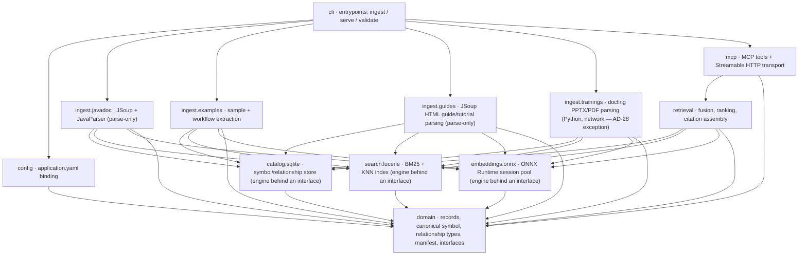
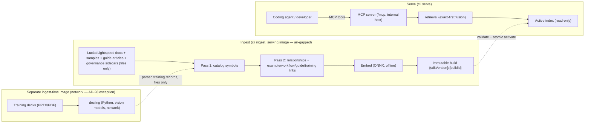
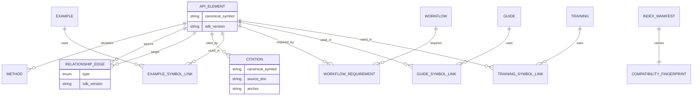

# Architecture Spine — LuciadLightspeed Knowledge MCP

## System Structure

**One Java program, built as a single deployable process, split into modules.** At the center is the `domain` module: plain data types and rules (records, the canonical-symbol format, relationship types) with no dependency on any database, framework, or file I/O. The storage and compute engines — SQLite (catalog), Lucene (search), ONNX (embeddings) — are reached only through interfaces that `domain` defines, so any one of them can be replaced without touching the core. Ingestion, retrieval, and the MCP surface are the outer modules that drive the core through those interfaces. Every module depends inward toward `domain`, and `domain` depends on nothing.

`packaging` is a build-time/deployment concern (container image, baseline posture — AD-27), not a Java package; it wraps the built `cli` artifact and has no compile-time dependency edge into the module graph below.

Module → package map (root `com.luciad.knowledge`):



`ingest.trainings` is packaged and shipped separately from every other module above (AD-28) — it never ships inside the container image that runs `serve`.

## Invariants & Rules

### AD-1 — Dependencies point inward to `domain`; no cycles `[ADOPTED]`
- **Binds:** all modules
- **Prevents:** tangled coupling; `mcp`/`cli` reaching into parsers; engine leakage into `domain`.
- **Rule:** `domain` has zero dependencies on other project modules or on SQLite/Lucene/ONNX types. Engines are reached only through interfaces defined in `domain` (`CatalogStore`, `LexicalIndex`, `VectorIndex`, `Embedder`). No module import cycle may exist; `mcp`/`retrieval` never import `ingest.*` and never call parser types.

### AD-2 — Embedded engines only; single internal-host listener `[ADOPTED]`
- **Binds:** catalog.sqlite, search.lucene, embeddings.onnx, mcp
- **Prevents:** anyone introducing an external database, search server, model server, or a second network service.
- **Rule:** SQLite, Lucene, and ONNX run in-process as libraries. The only listening socket is the MCP Streamable HTTP transport, bound to the internal host interface reachable by the trusted team (v1); it is never exposed to the public internet. No component opens any other server socket or connects to an external data/model service. *(Amended 2026-08-24 — v1 bind widened from loopback to the shared internal host to serve a small trusted team; the zero-external-egress guarantee is unchanged.)*

### AD-3 — Canonical symbol is the universal join key
- **Binds:** domain, catalog.sqlite, search.lucene, ingest.*, retrieval, mcp
- **Prevents:** two modules inventing different symbol-string formats, breaking joins between catalog, index, examples, and citations.
- **Rule:** Every record, relationship edge, example link, and citation references API elements by the single canonical symbol key (plus its defined normalized variants) minted in `domain`. Overloads are distinguished by the canonical form. No module derives its own symbol string. *(Exact string format is a `[NEEDS APPROVAL]` gate — see Deferred — but its role as sole identity is fixed here.)*

### AD-4 — Two-pass ingestion; never fabricate `[ADOPTED]`
- **Binds:** ingest.javadoc, ingest.examples, ingest.guides, catalog.sqlite
- **Prevents:** forward-reference races; guessed/hallucinated symbols entering the catalog.
- **Rule:** Pass 1 builds the full symbol catalog. Pass 2 resolves relationships, cross-references, and example/workflow/guide links against the completed catalog. A reference that does not resolve to a catalog symbol is recorded as explicitly unresolved — never invented, never silently dropped.

### AD-5 — Immutable index builds; validate-then-atomic-activate `[ADOPTED]`
- **Binds:** catalog.sqlite, search.lucene, cli, mcp
- **Prevents:** two writers on a live index; torn reads; serving a half-built index.
- **Rule:** Each build writes to a new immutable directory keyed by `{sdkVersion}/{buildId}`. It is validated before activation. Activation is an atomic swap of the active-index pointer. The serving process opens indexes read-only and never mutates an active index; rollback is re-pointing to a prior build.

### AD-6 — Compatibility fingerprint gate on load `[ADOPTED]`
- **Binds:** domain, mcp, embeddings.onnx, search.lucene
- **Prevents:** serving an index built with one schema/model against an incompatible runtime.
- **Rule:** Each build's manifest carries a compatibility fingerprint over {catalog schema version, Lucene index major, canonical-symbol format version, embedding model id, embedding dimension, tokenizer id, text-preprocessing version}. On load the server recomputes the runtime fingerprint and refuses to activate any index whose fingerprint mismatches. (NFR-14)

### AD-7 — Exact-symbol priority is inviolable `[ADOPTED]`
- **Binds:** retrieval, catalog.sqlite, mcp (search_api, resolve_symbol, check_symbols)
- **Prevents:** the semantic layer overriding ground truth — the core anti-hallucination guarantee.
- **Rule:** Exact symbol resolution/validation runs against the catalog first and is authoritative. Hybrid fusion may add semantic candidates but must never demote or displace a confirmed exact match, and never promotes a semantic candidate to "valid symbol." `check_symbols` marks a symbol valid only if it exists in the catalog for the target version; unknown is always reported unknown. Ordered by AD-7a: version scope binds before this rule applies.

### AD-7a — Version scope is resolved before exact resolution
- **Binds:** retrieval, catalog.sqlite, mcp (resolve_symbol, check_symbols)
- **Prevents:** two conforming implementations interleaving AD-7 ("exact-first") and AD-12 ("version-scoped") in opposite orders and returning opposite verdicts for the same symbol.
- **Rule:** The effective SDK version (explicit caller argument, else the configured default) is bound *before* any catalog lookup. Exact resolution and validation (AD-7) are authoritative only within that bound version. A symbol existing solely in a non-target version is reported `unknown` for the target version, optionally with an "exists in other versions" hint only when the caller opted into cross-version. AD-7 orders exact vs. semantic; it never overrides AD-7a's version binding.

### AD-8 — Identical embedding fingerprint at index-time and query-time `[ADOPTED]`
- **Binds:** embeddings.onnx, ingest.*, retrieval
- **Prevents:** index/query embedding-space mismatch producing silently wrong similarity.
- **Rule:** The same model, tokenizer, text preprocessing, normalization, output dimension, and any query/passage prefix convention are used when building vectors and when embedding queries. These parameters are sourced from one shared configuration and recorded in the manifest fingerprint (AD-6).

### AD-9 — Offline invariant: zero egress `[ADOPTED]`
- **Binds:** all modules except `ingest.trainings`, which carries the sole, explicitly-scoped exception defined by AD-28
- **Prevents:** an accidental network dependency (model download, update check, telemetry) breaking the air-gap guarantee.
- **Rule:** Neither ingest nor serve performs DNS, HTTP(S), telemetry, model download, or update checks. The embedding model and tokenizer are loaded only from a configured local filesystem path. Any build dependency is vendored/mirrored offline. (NFR-11) *(Scoped exception for `ingest.trainings` carved out by AD-28, 2026-08-21, Sprint Change Proposal — this rule is otherwise unchanged.)*

### AD-10 — Parse-only: never compile or execute `[ADOPTED]`
- **Binds:** ingest.javadoc, ingest.examples, ingest.guides — NOT `ingest.trainings`, which carries the sole, explicitly-scoped exception defined by AD-28
- **Prevents:** anyone adding a compile/build/run step against ingested samples, guide articles, or generated applications.
- **Rule:** Ingestion uses JSoup (HTML) and JavaParser (source AST) statically. JavaParser runs without symbol-solving against SDK binaries/JARs. No module compiles source, resolves against class files, invokes Maven/Gradle, or executes any ingested sample, guide code snippet, or generated application. *(Scoped exception for `ingest.trainings` carved out by AD-28, 2026-08-21, Sprint Change Proposal — this rule is otherwise unchanged.)*

### AD-11 — Bounded responses everywhere `[ADOPTED]`
- **Binds:** mcp (all 20 tools), retrieval
- **Prevents:** unbounded payloads exhausting memory or the agent's context.
- **Rule:** Every tool enforces default page size 10, hard cap 50, and a ≤1 MiB response ceiling, emitting explicit truncation metadata when limits bite. Full class/method source or full documents are returned only by the dedicated `get_*` tools. (NFR-10)

### AD-12 — SDK-version scoping is mandatory
- **Binds:** domain, catalog.sqlite, search.lucene, retrieval, mcp
- **Prevents:** cross-version contamination between documented SDK releases.
- **Rule:** Every record, edge, index segment, and query carries an SDK version. Retrieval is scoped to a single version; the server has one explicitly-configured default version. No cross-version results are returned unless the caller requests them.

### AD-13 — ONNX session pool for concurrency; stateless retrieval
- **Binds:** embeddings.onnx, retrieval, mcp
- **Prevents:** shared-mutable ONNX-session data races and single-session serialization that would violate the concurrency target.
- **Rule:** Embedding inference is served by a bounded, thread-safe pool of ONNX sessions sized to satisfy ≥4 concurrent requests (NFR-3) with a bounded work queue (reject/queue, never unbounded). Retrieval handlers are stateless per request over the read-only active index; no request mutates shared state. *(Resolves PRD open question Q6.)*

### AD-14 — Trust metadata is input, never inferred
- **Binds:** ingest.examples, ingest.guides, ingest.trainings, retrieval, domain
- **Prevents:** parsers fabricating quality/trust signals.
- **Rule:** Quality labels, provenance, and trust for examples/workflows originate from governance-controlled sidecar inputs. Parsers record only what the source states; they never assign or infer a quality label.
- **Open (2026-08-21, Sprint Change Proposal):** whether `Guide` records get a governance quality-tag sidecar under this same rule (like examples/workflows) or ship untagged, since guides are vendor-authored rather than team-curated, is a `[NEEDS APPROVAL]` design question for the architect — see Deferred. Until resolved, `ingest.guides` assigns no quality label.
- **Open (2026-08-21, Sprint Change Proposal):** the same open question now also applies to `Training` records — user explicitly chose to leave it open/deferred rather than decide now. Until resolved, `ingest.trainings` assigns no quality label.
- **Amendment (2026-08-21, Sprint Change Proposal — see AD-29):** this same sidecar mechanism is extended to a second, independent metadata field — the technique tag — supplied for `Example`, `Workflow`, `Guide`, and `Training` records from a curated fixed vocabulary. Technique tags are orthogonal to the two "Open" quality-label questions above: a record may carry technique tags while its own quality-label question remains unresolved, since the two are governed by separate sidecar fields with independent open/closed status.

### AD-15 — Citation completeness for primary results
- **Binds:** retrieval, mcp, domain
- **Prevents:** uncited or unverifiable answers reaching the agent.
- **Rule:** Every primary result carries a full citation tuple (source document, SDK version, anchor/locator, plus the canonical symbol when one is resolved for that record). A record lacking complete provenance is never served as a primary result; a record with complete provenance but no resolved canonical-symbol link is still fully citation-complete and servable — canonical symbol is omitted, never fabricated, in that case. (FR-30, FR-31)
- **Amendment (2026-08-21, Sprint Change Proposal):** the rule as originally written required canonical symbol unconditionally in every citation tuple, which would have made any symbol-less `Guide`/`Training`/`Workflow` record permanently unservable as a primary result — a hard-blocking defect, not a soft discoverability gap. This amendment makes canonical symbol conditional (present when resolved, omitted when not) while keeping source document, SDK version, and anchor/locator always required.

### AD-16 — Single-file config; redacted logging
- **Binds:** config, mcp, all modules that log
- **Prevents:** leaking proprietary corpus content into logs; hidden runtime inputs.
- **Rule:** `application.yaml` is the sole runtime configuration input. Logs never emit full document bodies or source text by default (redaction). Active retrieval mode, active embedding model, and active index identity are observable only through the `index_status` tool / structured logs — not by dumping content.

### AD-17 — `cli ingest` is the sole build coordinator; single manifest author
- **Binds:** cli, ingest.javadoc, ingest.examples, catalog.sqlite, search.lucene, embeddings.onnx, domain
- **Prevents:** two ingest modules each legally minting their own `buildId` and build directory for one logical build, splitting the catalog across two immutable dirs (adversarial review H1).
- **Rule:** `cli ingest` is the sole build coordinator. It computes the one `buildId` as a content hash over the complete, ordered set of build inputs (docs + samples + governance sidecars + the effective embedding/preprocessing config), creates the `{sdkVersion}/{buildId}` directory exactly once, and passes an opaque `BuildContext` (target dir + sealed input digest) to `ingest.javadoc` and `ingest.examples`. Ingest modules never mint a `buildId` and never create a build directory. `domain` defines one `IndexManifest` builder; each engine adapter contributes exactly one fingerprint component through a `domain` port; the coordinator seals the manifest exactly once, and AD-5 validation fails if any component is missing or contributed twice.

### AD-18 — One cross-boundary canonical-symbol join variant
- **Binds:** domain, catalog.sqlite, search.lucene, retrieval, ingest.*
- **Prevents:** catalog and index each legally choosing a different "defined normalized variant" of the canonical symbol (AD-3), silently missing the join and defeating exact-first fusion (adversarial review H2).
- **Rule:** `domain` designates exactly one canonical-symbol variant as the wire/join key, used for every cross-module reference: catalog rows, edges, example/workflow links, the Lucene stored-id field, citations, and every fusion join in `retrieval`. All other normalized variants are module-internal only and must never cross a port boundary. `retrieval` joins strictly on the wire/join key; a candidate lacking it is not fusable. The Deferred canonical-symbol serialization gate must specify this join variant, not only the string grammar.

### AD-19 — Canonical retrieval pipeline order and `total` definition
- **Binds:** retrieval, mcp
- **Prevents:** `retrieval` and `mcp` each applying AD-11 (bounded pagination) and AD-15 (citation-completeness) in a different order, giving `total` two incompatible meanings and breaking agent pagination (adversarial review H4).
- **Rule:** Pipeline order is fixed: (1) bind version (AD-7a) → (2) exact-first fusion (AD-7) → (3) citation-completeness filter (AD-15) → (4) deterministic ranking (AD-20) → (5) bounded pagination (AD-11). `total` is the count of citation-complete, version-scoped, fused candidates *before* pagination; `truncated` reflects step 5 only. `retrieval` performs steps 1–4 and returns the full ranked, filtered candidate set plus `total`; `mcp` performs only step 5. This full pipeline applies only to **primary-result** tools (AD-24); for **verdict/navigation** tools, step 3 is skipped entirely — AD-24 governs and citation is never a drop criterion.

### AD-20 — Total deterministic result order
- **Binds:** retrieval, search.lucene
- **Prevents:** two builds of `retrieval` returning different top-10 orderings for the same query and index because tied fused scores fall back to collection-iteration or thread-scheduling order, violating reproducibility (adversarial review H5, NFR-13).
- **Rule:** Fusion imposes a total order: primary key is the fused score (one declared fusion method, fixed here or by the F5 selection gate); secondary tie-break is the canonical wire/join key (AD-18) ascending. No result ordering may depend on collection iteration order, thread scheduling, or wall-clock. Identical (index, query, config) must yield byte-identical ordered results.

### AD-21 — Text preprocessing lives once, behind the Embedder interface
- **Binds:** embeddings.onnx, ingest.javadoc, ingest.examples, retrieval
- **Prevents:** index-time and query-time preprocessing implemented separately by each caller, both stamping the same config version yet silently diverging (adversarial review H6, defeats AD-8).
- **Rule:** All text preprocessing, tokenization, normalization, and query/passage prefixing are implemented solely inside `embeddings.onnx` behind the `Embedder` interface. That interface accepts raw text plus a role (`QUERY` | `PASSAGE`) and returns the vector; no other module preprocesses text destined for embedding. The `text-preprocessing version` in the AD-6 fingerprint is owned and stamped by `embeddings.onnx` from its own code version, not from config alone.

### AD-22 — `catalog.sqlite` is the sole authority for record/edge identity
- **Binds:** catalog.sqlite, ingest.javadoc, ingest.examples, domain
- **Prevents:** two ingest modules independently hashing the same logical fact into different IDs (or different facts colliding into one ID) because "canonical identity fields" per entity was unspecified (adversarial review H7).
- **Rule:** `catalog.sqlite` (the engine implementation) is the sole authority that computes edge/link/record IDs, from an `identityFields` spec declared in `domain`, per entity, applied to the wire/join key (AD-18). Ingest modules submit resolved logical tuples through `CatalogStore`; they never compute IDs and never assume a hash recipe. The store deduplicates by computed ID.

### AD-23 — Pointer-write ownership and cross-process observation contract
- **Binds:** cli, mcp, retrieval
- **Prevents:** a data race between the process activating a build and the live `serve` process, since AD-5/AD-2 forbid `serve` mutating the index but leave the pointer-write and cross-process observation path unowned (adversarial review H8).
- **Rule:** Only `cli` writes the active-index pointer, via atomic rename of a fully-written temp pointer — never an in-place edit. The live `serve` process re-resolves the pointer at a defined boundary (start of each request, or an explicit reload); because builds are immutable (AD-5), an in-flight request continues safely against the directory it already opened. A build directory is never deleted while any pointer or open handle references it; rollback and GC of old builds are `cli`-only, gated on zero references.

### AD-24 — Every MCP tool is enumerated as primary-result or verdict/navigation
- **Binds:** mcp, retrieval
- **Prevents:** AD-15's citation-completeness drop colliding with AD-7's "unknown is always unknown, known is known" guarantee when applied to a validation tool like `check_symbols` (adversarial review H9).
- **Rule:** Each of the 20 tools is enumerated as either **primary-result** (content/retrieval tools — `search_api`, `get_*`, example/workflow/guide/training retrieval including `search_guides`/`get_guide`, `search_trainings`/`get_training`, and `search_concepts` — subject to the AD-15 citation-completeness drop, applied at AD-19 step 3) or **verdict/navigation** (`check_symbols`, `resolve_symbol`, `index_status` — report catalog ground truth per AD-7/AD-7a/AD-12, bypass AD-19 step 3 entirely, and are never dropped for missing citation). `citation` is required on primary-result payloads and absent (not empty) on verdict/navigation payloads. *(Tool count 17 → 19 and `search_trainings`/`get_training` added, 2026-08-21, Sprint Change Proposal. Tool count 19 → 20 and `search_concepts` added, 2026-08-21, Sprint Change Proposal.)*

### AD-25 — Checkpointed ingestion writes to build-scoped staging only
- **Binds:** cli, ingest.javadoc, ingest.examples, embeddings.onnx
- **Prevents:** resume/checkpoint support for large-corpus embedding (brief) being read as license to mutate a partially-built directory in place, which would collide with AD-5's immutable-build guarantee and AD-17's single-seal rule.
- **Rule:** Checkpoints are written only inside the coordinator-owned `BuildContext` staging area (AD-17) for the in-progress `{sdkVersion}/{buildId}`, never to an already-sealed build directory. A resumed run re-attaches to the same `buildId`'s staging area (matched by its sealed input digest) and continues; if the input set changed, it is a new `buildId`, not a resume. Checkpoint state is invisible to `serve` — only a validated, activated build is ever observable (AD-5, AD-6).

### AD-26 — Lexical-fallback and model-load failure are explicit, never silent `[ADOPTED]`
- **Binds:** embeddings.onnx, retrieval, mcp (index_status)
- **Rule:** Embedding model load failure is always explicit (fails ingestion, or fails startup for `serve`) — never silently swallowed. Falling back to lexical-only retrieval happens only when explicitly enabled by configuration, and that degraded mode is always visible via `index_status`. Hybrid retrieval never silently degrades to lexical-only without both the config opt-in and the status signal.
- **Prevents:** a caller or downstream agent believing hybrid (lexical+vector) retrieval ran when it silently degraded to lexical-only, producing a quality regression with no observable signal (FR-18).

### AD-27 — Container baseline posture is a build/packaging invariant `[ADOPTED]`
- **Binds:** packaging, cli
- **Prevents:** the operational/security envelope (NFR-12, FR-32) being left to each deployment's discretion instead of being fixed in the shipped artifact.
- **Rule:** The shipped container runs as a non-root user, mounts the root filesystem read-only where practical, drops Linux capabilities, sets `no-new-privileges:true`, and mounts proprietary corpus/model inputs read-only. These are standard container-hygiene defaults for an internal deployment, not a hardened public-facing appliance. Ingestion and serving remain separable one-shot vs. long-running invocations of the same image (brief §14) — never fused into one always-mutable process.
- **Amendment (2026-08-21, Sprint Change Proposal):** This image is the *serving image*. It runs `ingest` (for the four offline record types: Javadoc, examples, workflows, guides), `validate-index`, and `serve`. It never contains docling, Python, or any network-capable tooling. Training-material ingestion (AD-28) ships and runs from a distinct, ingest-time-only image that is never deployed as, or alongside, the serving image.
- **Amendment (2026-08-24):** v1 serves a small trusted internal team from a shared internal host — the "hardened appliance" framing and the loopback bind are dropped; the container-hygiene defaults above are retained. True hardening (authentication, TLS, tenant isolation) belongs to a future deployment profile, not v1.

### AD-28 — Training-material ingestion is a scoped, explicit exception to AD-9/AD-10 `[ADOPTED]`
- **Binds:** cli, ingest.trainings
- **Prevents:** the docling-based training-deck exception being read as a general relaxation of the zero-egress (AD-9) or parse-only (AD-10) invariants for any other module, input type, or the serving appliance.
- **Rule:** `ingest.trainings` is the sole module permitted network access (to fetch/run docling's vision-layout models) and the sole module permitted to shell out to non-Java tooling (Python/docling), and only when invoked via `cli ingest` against the local training-materials directory (FR-1's sixth permitted path). This exception is confined to `ingest.trainings`; every other module remains bound by AD-9 and AD-10 unchanged. `ingest.trainings` is built, packaged, and shipped as a separate, ingest-time-only container image (AD-27 amendment) — it is never present in, or reachable from, the hardened serving image that runs `cli serve`. The served MCP appliance (Epic 8, NFR-11) remains fully air-gapped and zero-egress; only the offline `cli ingest` step for training decks gains network access, and only inside that separate image. Docling's parsed output (section titles, ordered text blocks, extracted tables/figures) is submitted to `catalog.sqlite` through the same `CatalogStore`/two-pass discipline as every other record type (AD-4, AD-22) — the exception is scoped to *how the input is read*, never to *how it is cataloged, linked, or served*. Docling's extracted output is frozen as the source-of-record ingestion input; downstream record IDs and content hashes are computed deterministically from that frozen output (NFR-13, AD-22), never by re-running docling's network-fetched, unpinned vision model.

### AD-29 — Technique tags are a secondary, non-symbol join key `[ADOPTED]`
- **Binds:** ingest.examples, ingest.guides, ingest.trainings, catalog.sqlite, search.lucene, retrieval, mcp, domain
- **Prevents:** cross-cutting coding-technique/best-practice content — and any record with no resolved canonical-symbol link (a symbol-less `Guide` or `Training` record) — from being permanently unjoinable and undiscoverable, since canonical symbol (AD-3, AD-18) is the *sole* cross-boundary join key today.
- **Rule:** `domain` declares a curated, fixed vocabulary of technique-tag values (governed the same way as AD-14's quality labels — sidecar-supplied, never parser/ML-inferred). `Example`, `Workflow`, `Guide`, and `Training` records (never `ApiElement`/`MethodElement`) may carry zero or more technique tags. A technique tag is a **secondary join key**: `retrieval` may group/fuse candidates across record types by shared technique tag, in addition to — never instead of — the canonical-symbol join (AD-18), which remains the sole *primary* join key. `catalog.sqlite` stores technique tags as an attribute on the owning record row (no new ERD entity, mirroring the quality-label precedent), and `search.lucene` indexes them as an exact-match filterable field alongside the existing quality filter (FR-17). The new `search_concepts` MCP tool (FR-43) is the primary consumer of this join key, federating matches across all four taggable record types into one fused, citation-complete list per the same convention as F5's hybrid fusion; an unrecognized tag value is rejected, never silently ignored or coerced to the nearest known value.
- **Consequence:** a `Guide` or `Training` record with no resolved canonical-symbol link is no longer permanently unjoinable — it remains discoverable via `search_concepts` and via technique-tag filtering on the existing search tools, closing the gap AD-15's conditional-canonical-symbol amendment (above) made possible to serve but did not by itself make *discoverable*.

## Consistency Conventions

| Concern | Convention |
| --- | --- |
| Module / package naming | Root `com.luciad.knowledge`; one package per module (`domain`, `config`, `ingest.javadoc`, `ingest.examples`, `ingest.guides`, `ingest.trainings`, `catalog.sqlite`, `search.lucene`, `embeddings.onnx`, `retrieval`, `mcp`, `cli`). Interfaces live in `domain`; their implementations live in each engine module. `ingest.trainings` alone is packaged/shipped separately (AD-28). |
| Record & entity naming | Domain records are immutable Java `record` types (`ApiElement`, `MethodElement`, `Example`, `Workflow`, `Guide`, `Training`, `RelationshipEdge`, `Citation`, `IndexManifest`). |
| Relationship types | Fixed enum, `UPPER_SNAKE_CASE`, exactly the 15 brief §6 values; no ad-hoc additions without an AD amendment. |
| IDs | Deterministic: record/edge IDs are stable hashes over canonical identity fields (reproducibility, NFR-13); `buildId` is a content hash of the build inputs; never random, never wall-clock-derived. |
| Dates & versions | ISO-8601 UTC timestamps; SDK version is an explicit string field on every record/edge/query. |
| Tool I/O & error shape | MCP tool payloads are JSON with a single documented envelope: `results[]` + `truncated` + `total` + `citation` where applicable; errors use one structured error shape (`code`, `message`, `symbol?`) — never free-text-only. |
| State & mutation | Serving is read-only over the active index; the only mutation path is a build writing a *new* immutable directory (AD-5). |
| Logging & config | Redacted by default (AD-16); config solely from `application.yaml` (AD-16); no secrets required in v1 (trusted internal network, offline). |

## Stack

*Verified current 2026-08-20; the code owns these once it exists.*

| Name | Version |
| --- | --- |
| Java (JDK) | 21 (LTS) — pin `[NEEDS APPROVAL]` per blocker B5 (21 vs org LTS; note Java 25 became the newest LTS 2025-09, so B5 is 21 vs 25-vs-org-standard) |
| Build | Gradle (multi-project, Kotlin DSL — `settings.gradle.kts` + per-module `build.gradle.kts`; wrapper pinned to Gradle 8.10) |
| Apache Lucene | 10.5.1 (brief said 10.4.0 — bind latest patch) |
| MCP Java SDK | 2.0.1 |
| ONNX Runtime (Java) | 1.29.0 |
| SQLite JDBC (Xerial) | 3.53.2.1 |
| JSoup | 1.23.1 |
| JavaParser | 3.28.2 |
| Embedding model | BAAI/bge-small-en-v1.5, 384-dim — **CANDIDATE only**, subject to selection gate (Deferred) |
| Python (offline model prep/eval only — never in production path) | 3.x tooling, out-of-band |
| docling (training-deck ingestion, `ingest.trainings` only — network-enabled, AD-28 exception, ships only in the separate ingest-time image) | `[NEEDS APPROVAL]` — version pin deferred; distinct from, and never mixed with, the offline-eval-only Python row above |

## Structural Seed

### Source tree (brief §4)

```text
<repo root>/                      # planning + BMAD artifacts (_bmad/, _bmad-output/, docs/) live here, beside app/
app/                              # Gradle build root — rootProject.name = luciad-knowledge-mcp (all paths below are relative to app/)
  settings.gradle.kts             # Gradle multi-project aggregator (includes all modules)
  build.gradle.kts                # root build: shared Java 21 config + AD-1 checkDependencyDirection task
  gradle/libs.versions.toml       # version catalog (dependency pins)
  gradlew, gradlew.bat, gradle/   # Gradle wrapper (pinned to 8.10)
  compose.yaml, Dockerfile        # packaging: image build + container baseline (non-root, read-only FS, cap-drop) — AD-27
  scripts/                        # build-bundle.sh, ingest.sh, start.sh, smoke-test.sh (release-engineering, not runtime)
  agent/SKILL.md                  # agent-usage guidance shipped alongside the appliance (FR-30/31 support)
  tools/evaluation/                # offline model prep/eval (Python) — never in the production path, per brief §4
  src/main/java/com/luciad/knowledge/
    cli/                          # ingest | serve | validate entrypoints
    config/                       # application.yaml binding
    domain/                       # records, canonical symbol, relationship enum, interfaces, manifest
    ingest/javadoc/               # JSoup + JavaParser, parse-only
    ingest/examples/              # sample & workflow extraction + governance sidecar
    ingest/guides/                # JSoup guide/tutorial HTML parsing + catalog linking, parse-only
    ingest/trainings/             # docling PPTX/PDF parsing + catalog linking (network, non-Java exec — AD-28; separate ingest-time image only)
    catalog/sqlite/               # CatalogStore adapter (symbols + adjacency, recursive CTE)
    search/lucene/                # LexicalIndex (BM25) + VectorIndex (KNN) adapters
    embeddings/onnx/              # Embedder adapter, ONNX session pool
    retrieval/                    # fusion, ranking, citation assembly
    mcp/                          # 20 MCP tools + Streamable HTTP (/mcp) + optional stdio
  src/main/resources/
    application.yaml              # sole runtime config (AD-16)
  models/                         # local ONNX model + tokenizer (loaded offline, AD-9)
  indexes/                        # immutable builds: {sdkVersion}/{buildId}/ + active pointer (AD-5)
```

`packaging` in the Capability map (AD-27) refers to this build/deployment layer (`compose.yaml`, `Dockerfile`, `scripts/`) — not a Java module.

### Container / dataflow



### Core-entity ERD



## Capability → Architecture Map

| Capability (PRD) | Lives in | Defined by |
| --- | --- | --- |
| F1 File-only offline ingestion (FR-1..3) | cli, ingest.* | AD-9, AD-10, AD-4 |
| F2 Javadoc parsing (FR-4..7) | ingest.javadoc | AD-4, AD-10, AD-3 |
| F3 Catalog + relationship graph (FR-8..11) | catalog.sqlite, domain | AD-3, AD-4, AD-12; relationship-type convention |
| F4 Examples, workflows & guides (FR-12..15, FR-35..36, FR-42) | ingest.examples, ingest.guides | AD-4, AD-10, AD-14, AD-3, AD-29 |
| F5 Hybrid retrieval (FR-16..20) | retrieval, search.lucene, embeddings.onnx | AD-7, AD-7a, AD-8, AD-13, AD-18, AD-19, AD-20, AD-21, AD-26 |
| F6 MCP surface — 20 tools (FR-21..25, FR-38, FR-41, FR-43) | mcp | AD-11, AD-2, AD-7, AD-19, AD-24, AD-29, tool-envelope convention |
| F7 Index lifecycle (FR-26..29) | cli, catalog.sqlite, search.lucene, domain | AD-5, AD-6, AD-12, AD-17, AD-22, AD-23, AD-25 |
| F8 Agent guidance & citations (FR-30..31) | retrieval, mcp | AD-15, AD-7, AD-24 |
| F9 Packaging / deploy / security (FR-32..34) | cli, config, packaging | AD-2, AD-9, AD-16, AD-27 |
| F10 Training-material ingestion via docling (FR-39..41, FR-42) | ingest.trainings | AD-28, AD-4, AD-3, AD-22, AD-29 |
| NFR-3 concurrency | embeddings.onnx, retrieval | AD-13 |
| NFR-13 reproducibility | domain, cli | ID convention, AD-5, AD-20 |
| NFR-14 compatibility enforcement | domain, mcp | AD-6 |
| NFR-12 security posture | packaging, cli | AD-27 |

## Deferred

- **`[NEEDS APPROVAL]` — MCP tool schemas.** Exact request/response JSON schema per tool (beyond the fixed envelope). Approval gate; owned by Epic 6.
- **`[NEEDS APPROVAL]` — SQLite catalog schema.** Table/column/index DDL and the adjacency + recursive-CTE relationship representation. Approval gate; Epic 3.
- **`[NEEDS APPROVAL]` — Lucene schema.** Field set, analyzers, BM25 params, KNN/HNSW vector field config. Approval gate; Epic 5.
- **`[NEEDS APPROVAL]` — Canonical-symbol & relationship serialization format.** The concrete string grammar for canonical symbols and normalized keys, and the on-disk edge format. Approval gate; Epic 3. (Identity role fixed by AD-3.)
- **Embedding model selection gate.** bge-small-en-v1.5 is a candidate only; final model + dimension + license + fingerprint + retrieval quality thresholds require the selection gate (PRD blockers B2/B3).
- **Reference hardware + corpus (B1) / gold retrieval set + top-5 threshold (B2).** Required to make NFR-1..9 and retrieval-quality acceptance testable; owned by Epic 8 / NFR test strategy.
- **JDK pin (B5).** Java 21 vs org current LTS — final pin before Epic 1 code.
- **Authenticated / TLS / multi-tenant (cross-team or org-wide) deployment profile.** Out of scope v1 — v1 serves a single trusted internal team on the internal network without auth (AD-2); revisit for a future authenticated profile.
- **Public-base / private-overlay index composition.** Not in v1; deferred packaging concern.
- **Corpus acquisition / provenance & license review (B3).** Legal gate for redistributing docs-derived indexes + model; owned by Epic 8 / release.
- **Governance role assignment (B4).** Roles defined; assignment to named people is an org action, prerequisite to every approval gate.
- **Malformed-page ingestion policy (fail-fast vs. collect-and-continue).** Brief makes this configurable; the default and the ingestion-report shape for the collect-and-continue path are an ingest.javadoc implementation detail, not a cross-module composition risk — owned by Epic 2.
- **`[NEEDS APPROVAL]` — Guide governance/quality-tagging model (2026-08-21, Sprint Change Proposal).** Whether `Guide` records get a governance-controlled quality-tag sidecar under AD-14 (like examples/workflows) or ship untagged since they are vendor-authored rather than team-curated. Must be resolved before Epic 3 Story 3.5 (guide parsing & linking) is sized.
- **`[NEEDS APPROVAL]` — Training governance/quality-tagging model (2026-08-21, Sprint Change Proposal).** Whether `Training` records get the same AD-14 governance-controlled quality-tag sidecar treatment (like examples/workflows), ship untagged, or stay open — user explicitly chose to leave this open/deferred, same treatment as the still-unresolved Guide question above. Must be resolved before Epic 9's stories are sized.
- **`[NEEDS APPROVAL]` — Initial technique-tag vocabulary content (2026-08-21, Sprint Change Proposal).** AD-29 fixes the *mechanism* (curated, fixed vocabulary, sidecar-supplied, secondary join key) and governance model, but the actual list of tag values (e.g. `resource-lifecycle`, `builder-pattern`) is a corpus-owner content decision, independent of and not blocked by the still-open Guide/Training quality-tag questions above. Must be resolved before Epic 3 Story 3.3 (amended), Epic 5 Story 5.3d, and Epic 9 Story 9.3 are sized.
- **Build retention count and backup/rollback atomicity beyond AD-23's GC-safety.** How many prior builds are retained and the exact backup procedure are ops-policy details within `cli`'s sole ownership (AD-23); no second writer exists to diverge — owned by Epic 7.
