# 🛰️ LuciadLightspeed Knowledge MCP (`luciad-mcp`)

> **Stop your coding agent from inventing APIs.** An offline, air-gapped knowledge service that feeds AI coding agents *real, cited* LuciadLightspeed symbols — and never marks a guess as verified. ✨

  
  
  
  
  
  

---

## 🚀 Executive Summary

luciad-mcp is an offline knowledge service that lets an AI coding agent use the proprietary LuciadLightspeed Java SDK without inventing APIs. It ingests the SDK's own Javadocs, curated code examples, task workflows, vendor guides, and training decks into local indexes, then serves that knowledge to a coding agent through the Model Context Protocol (MCP): exact symbol lookup, type-relationship traversal, and natural-language search — every result grounded in a cited source.

The core guarantee is negative and deliberate: the service **never reports an unknown symbol as verified**. Coding agents hallucinate LuciadLightspeed APIs because they generate from training memory, and a commercial SDK like this is thinly represented there. luciad-mcp replaces memory with an authoritative catalog. It retrieves and verifies; it does not generate — code generation stays in the developer's own agent.

It runs fully offline. It ships as a Docker image, runs on a shared internal host, and makes zero external network calls while serving — one instance serves the whole team (v1 targets a small team of 4–5 developers). That constraint is the point: the environment has no internet access, and the SDK's documentation stays inside it.

## 🔥 The Problem

Developers integrating LuciadLightspeed point a coding agent at the task, and the agent confidently writes code against packages, classes, methods, and overloads that do not exist. This happens because the SDK is proprietary and under-represented in model training data, so the agent fills gaps by guessing. The failure is expensive in exactly the wrong way — the code looks plausible, seems correct on inspection, and only fails against the real API.

Two things make the usual fixes unavailable. First, the environment is air-gapped: no calling a hosted docs service, no cloud embeddings, no telemetry. Second, correctness here is not "close enough" — an invented overload is worse than no answer, because it sends the developer down a path that fails late. The developer needs real, current symbols with citations, delivered entirely inside the air gap.

## 💡 The Solution

luciad-mcp is an MCP server delivered as one Docker image with three modes:

- 📥 **ingest** — read a local corpus (Javadocs, examples, workflows, guides, training decks) and build the indexes. File-only; it never crawls.
- ✅ **validate-index** — check a built index before it goes live.
- 🛰️ **serve** — long-running, read-only over an immutable index, serving the team from a shared internal host.

Internally, it builds a versioned SQLite catalog of **canonical symbols** plus a typed **relationship graph** (15 fixed relationship types — extends, implements, parameter-type, and so on). Retrieval is hybrid: exact-symbol matching takes priority, backed by lexical (BM25) and vector search, with a visible fallback so the agent always knows how a result was found.

The knowledge is organized into **5 record types** — API element, Example, Workflow, Guide, and Training — and exposed through **20 MCP tools**. The tools fall into two classes:

- **Content retrieval** — find the right example, workflow, guide, training section, or class/method (`search_api`, `get_class`, `search_examples`, `search_concepts`, relationship traversal, etc.).
- **Verdict and navigation** — report catalog ground truth (`check_symbols`, `resolve_symbol`, `index_status`). These are the tools that let an agent verify before finalizing code, and they never guess.

Everything hangs off one **join key**: a canonical symbol (`pkg.Type#method(ParamType)`) is the universal identity for every record, edge, example link, and citation — no module invents its own format. A secondary join key, curated **technique tags**, groups cross-cutting content and lets symbol-less material (some guides and training sections) be discovered even when it maps to no single API symbol.

## ⚙️ How It Works

luciad-mcp is one Java program that runs in two roles — **build** the index, then **serve** it — and makes no external network calls while serving. Its core data and rules sit behind interfaces, so the three engines it relies on (SQLite for the catalog, Lucene for search, ONNX for embeddings) run in-process and could be swapped without touching the core.

**Building the index** (one-shot, per SDK version). A single coordinator hashes the full input set into an immutable build, then runs fixed stages: parse the source material — Javadoc HTML (JSoup), code examples (JavaParser), and training decks (docling) — into one record per API element and per content section; resolve the links between API elements into a 15-type relationship graph in a two-pass sweep so nothing is invented; link examples, guides, and decks to the catalog on the canonical symbol; build the search structures — keyword (BM25) and meaning-based (ONNX embeddings + vector index); then validate and seal it. Each build is tagged to one SDK version, switched on by an atomic pointer swap, and rolled back by pointing at the previous build. The deck parser runs as its own build-time step because docling needs Python and network access; its output is frozen and fed through the same catalog path, and the served appliance stays fully offline.

**Serving it** (long-running). A coding agent calls the 20 tools over the MCP protocol. Every query runs the same fixed pipeline: scope to the requested SDK version first, resolve exact symbols against the catalog, fuse in keyword and meaning-based matches (an exact match always wins and is never displaced by a fuzzy hit), drop anything that isn't fully cited, then rank deterministically so the same query always returns the same result. Verdict tools (`check_symbols`, `resolve_symbol`) report catalog ground truth and never guess — unknown symbols come back as unknown.

```mermaid
flowchart LR
  subgraph BUILD["Build-time · ingest (one-shot per SDK version)"]
    direction TB
    inputs["Local corpus<br/>Javadocs · examples · guides · training decks"]
    parse["Parse & extract<br/>JSoup · JavaParser · docling"]
    cat["Canonical symbol catalog<br/>+ 15-type relationship graph"]
    idx["Search structures<br/>BM25 keyword · ONNX vector"]
    seal["Validate + seal<br/>immutable build"]
    inputs --> parse --> cat --> idx --> seal
  end

  INDEX[("Immutable index<br/>{sdkVersion}/{buildId}<br/>SQLite + Lucene")]

  subgraph SERVE["Runtime · serve (long-running, offline)"]
    direction TB
    mcp["MCP server<br/>20 tools over /mcp"]
    scope["1 · scope to SDK version"]
    fuse["2 · exact-first fuse<br/>keyword + vector"]
    cite["3 · citation filter"]
    rank["4 · deterministic rank"]
    mcp --> scope --> fuse --> cite --> rank
  end

  agent(["Coding agent"])

  seal --> INDEX
  INDEX -->|read-only| scope
  agent -->|query| mcp
  rank -->|cited results / verdicts| agent
```

### 🧑‍💻 Coding best practices in examples

A natural question: when the SDK's example code demonstrates an idiom — try-with-resources for a closeable resource, declaring a variable by its interface rather than a concrete class — how does that survive into what the agent sees? The answer is that the system does not touch it. luciad-mcp retrieves, it does not generate: the example is served verbatim and cited, so the idiom the agent gets back is exactly the idiom in the curated source. It never rewrites code, and — by explicit rule — it never infers quality from code shape (a parser will not decide a bare `close()` is worse than try-with-resources).

Best-practice signal is carried by two human-supplied, governance-controlled labels, never guessed by the parser:

- **Quality label** — one of `official` / `validated` / `best-practice` / `illustrative` / `legacy`, attached per example so a curator can vouch that one is exemplary.
- **Technique tags** — a curated vocabulary of coding-technique labels (e.g. `resource-lifecycle`, `builder-pattern`) that lets an agent ask "show me every example demonstrating this technique" and get a cited list, even across guides and training material.

The consequence is a clean division: idiom fidelity is a corpus-curation responsibility (what goes in comes out), and the agent-facing `SKILL.md` is where the developer's agent is steered to prefer labeled examples. luciad-mcp surfaces the best-practice signal; it does not verify that the generated code followed it — that stays on the agent's side of the trust boundary.

## 🏆 What Makes This Different

- 🚫 **It never guesses.** Every primary result is validated against the canonical catalog and cited to its source, or it is not served. Semantic search can never promote an unknown symbol to "valid."
- 🔍 **It retrieves, it doesn't generate.** The developer's agent writes the code; luciad-mcp is only ever accountable for what it can cite. That keeps the trust boundary clean.
- 🔌 **No external dependencies to serve.** No external vector database, no LangChain/LlamaIndex, no local LLM, no network — the whole thing is self-contained and transferable into an air gap.
- 🧩 **One record per API element.** Overloads are distinct records, so the catalog reflects the API as it actually is rather than collapsing methods that differ.

These are advantages of scope discipline, not a technical barrier competitors can't cross. The value is in refusing to do the things that would let it return unverified results.

## 👥 Who This Serves

- **The developer** integrating LuciadLightspeed — wants authoritative API and context fed to their coding agent so they can trust the generated code.
- **The coding agent** — the direct consumer of the tools. It finds workflows and examples, resolves exact symbols and overloads, traverses type relationships, and validates symbols before finalizing code.
- **The release operator / corpus owner** — builds, validates, activates, and rolls back the immutable per-SDK-version indexes inside the air gap.

**Not served in v1:** anyone outside the trusted internal team — no public or cross-org access, and no per-user authentication or tenant isolation (v1 assumes a trusted internal network). (Full non-goals are in Scope.)

## 🎯 Success Criteria

The metrics below are the ones that define whether the product works. The PRD's full set carries additional, more granular validation targets — SM-6 (overload ambiguity always explicit), SM-7 (relationship-edge integrity), and SM-8 (hybrid ranking beats the lexical baseline) — that matter to implementation but not to this overview.

- **SM-1 — Exact lookup:** 100% correct canonical lookup on indexed fixtures.
- **SM-2 — Unknown-symbol safety:** an unknown symbol is never marked valid.
- **SM-4 — Citation completeness:** 100% of primary records carry a citation, or they are not served.
- **SM-5 — Version isolation:** no cross-version results unless explicitly requested.
- **SM-9 — Offline operation:** zero external network calls during ingest or serve.
- **SM-3 — Natural-language retrieval:** ≥ 90% of gold queries return the expected record in the top 5. *(Provisional — depends on a gold dataset not yet built; see risks.)*
- **Counter-metric SM-C1:** never improve SM-3 by weakening the exact-symbol safeguards.

The ranking matters: safety and citation guarantees (SM-1, SM-2, SM-4) come before retrieval breadth (SM-3). A more helpful server that occasionally validates a guess is a failed server.

## 📦 Scope

**In scope (v1):**
- File-only offline ingestion of Javadocs, examples, workflows, guides, and training decks
- Structural Javadoc parsing into a canonical symbol catalog and a 15-type relationship graph
- Governance-supplied quality labels and technique tags (curated, not inferred)
- Hybrid retrieval (exact-symbol priority + lexical + vector) across 20 MCP tools
- Immutable, versioned indexes with validate / activate / rollback
- Shared deployment on an internal host serving a small team (4–5 developers), an agent-facing `SKILL.md`, and an offline bundle (image tar, model, config, indexes, checksums, licenses)

**Explicitly out (non-goals):**
- Compiling or executing ingested samples or generated code (parse-only; no compiler in the loop)
- Hosting Maven/Gradle/Nexus artifacts, or running LuciadLightspeed itself
- Cloud embeddings, telemetry, or update checks during serving
- Per-user authentication, tenant isolation, or any access beyond the trusted internal network in v1
- Public or cross-org access
- Automated inference of coding techniques or quality — this metadata is governance-supplied

**Build-time network use:** training-deck ingestion via `docling` (which uses vision models) is the only step that touches the network, and it runs in its own build-time image. The served appliance stays fully offline.

## ⚠️ Open Questions & Risks

These are the gates standing between the current design and a buildable v1. Most need a person or a decision assigned, not more design:

- **B1 — Reference hardware and representative corpus undefined.** Until these exist, the latency, memory, and throughput targets are unfalsifiable.
- **B2 — Gold retrieval dataset not built.** The 90% top-5 target (SM-3) is provisional until it is.
- **B3 — Legal / license review not done.** Indexes and the embedding model are derivative documentation artifacts; redistribution needs sign-off.
- **B4 — Governance roles defined but unassigned.** Five named roles own the quality-label, technique-tag, and corpus sign-offs — they need names.
- **B5 — JDK pin undecided.** Java 21 vs. the org's approved LTS.
- **Embedding model not final.** BGE-small-en-v1.5 is a candidate pending a selection gate; changing it later forces a full re-embed and breaks index compatibility.
- **Open governance content:** whether Guides and Trainings carry quality tags, and the actual technique-tag vocabulary, are still open.

## 🔭 Vision

If v1 proves out with the team, the natural next step is a hardened, wider deployment — the same catalog and retrieval behind real authentication, audit, and tenant isolation, so more teams (or the whole org) can draw on one governed knowledge base. Beyond that, the pattern generalizes: what makes luciad-mcp work — a citable, never-guessing knowledge service for a proprietary SDK that runs offline — is not specific to LuciadLightspeed. Any organization with a proprietary API and coding agents that hallucinate against it has the same problem. The v1 discipline (verify, cite, never generate) is what makes that generalization safe rather than just broad.
