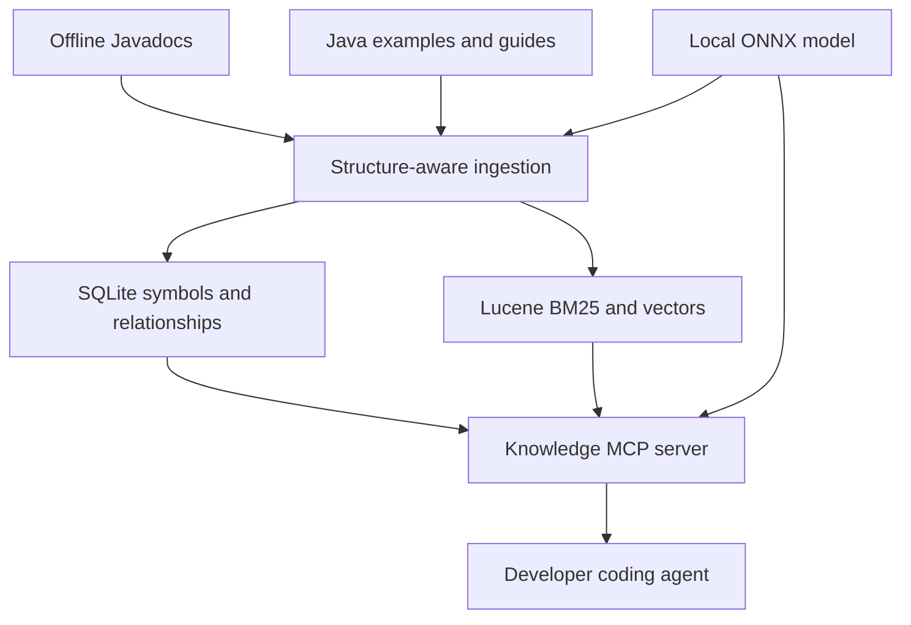

# LuciadLightspeed Knowledge MCP

> **Approved amendment — 2026-10-02 (planning only):** The approved Evidence-Backed Luciad First Proof change governs first-proof scope, interfaces, identity/evidence contracts and delivery order where it conflicts with this historical baseline. Earlier approved shared internal-host deployment remains binding. Historical text is retained for provenance, not as an instruction to reintroduce deferred work.
>
> The entire baseline below, including headlines, badges, counts, diagrams, workflow and kickoff instructions, is historical. The live proof has six tools (`search_knowledge`, `resolve_symbol`, `get_record`, `get_relationships`, `check_symbols`, `index_status`), exact/BM25 retrieval, selected approved content, contract freeze and controlled evaluation. The 17 SDK/example/workflow relationship types have separate producers (13 Javadoc, one workflow, three example); knowledge dependencies are separately frozen. Full guides, training/Docling, broad tags and vectors are deferred. Compile/test remains external. Source implementation is not applied; Story 2.5 review, technical contract approvals and release gates remain open.

> [Approved authority](../_bmad-output/initiative-luciad-mcp/change-evidence-backed-first-proof/change-evidence-backed-first-proof.md). See the reconciled PRD, Architecture Spine and epics for current acceptance.


## Implementation Brief and BMAD Handoff

**Status:** Final revised handoff; ready for BMAD planning and implementation  
**Audience:** Product owner, architect, implementing AI coding agent, and reviewers  
**Primary goal:** Build a portable, offline knowledge service that enables coding agents to use a proprietary LuciadLightspeed Java SDK accurately from its offline Javadocs and curated Java examples.

**Revision decisions:** The deployed appliance is a Java modular monolith. Natural-language retrieval is mandatory through hybrid BM25/vector search. Exact symbols and type relationships remain authoritative. SQLite stores the canonical catalog and relationship graph; Lucene provides BM25 and vector search; ONNX Runtime performs local embeddings. Python is permitted only for model preparation and retrieval evaluation, not in the production request path. Version 1 targets one local, per-developer container bound to loopback. The production ingester accepts local files only; acquiring public documentation is a separate release-engineering activity.

---

## 1. Product outcome

A developer should be able to set up the appliance, connect a compatible coding agent to its MCP endpoint, and ask:

> Build a LuciadLightspeed application that plots an object on a map.

The agent should then be able to:

1. Find a relevant workflow or example.
2. Discover the correct Luciad classes.
3. Retrieve exact constructors, method overloads, parameters, return types, and documentation.
4. Retrieve complete, trusted Java examples demonstrating correct usage.
5. Check proposed Luciad symbols against a canonical catalog before presenting code.
6. Cite the offline Javadoc page or example that supports each important API choice.

The system must substantially reduce invented packages, classes, methods, and overloads. It cannot absolutely guarantee semantically correct Java without compilation, but it must never report an unknown symbol as verified.

---

## 2. Confirmed scope

### Included

- Ingest thousands of offline LuciadLightspeed Javadoc HTML files.
- Ingest curated Java sample projects and explanatory Markdown/text files.
- Parse Javadocs structurally rather than as arbitrary fixed-size text chunks.
- Parse Java source sufficiently to preserve complete examples and identify Luciad imports and references.
- Build a canonical symbol catalog and documented API relationship graph.
- Capture linked parameter, return, field, exception, inheritance, implementation, override, and example-usage relationships.
- Build embedded local lexical and vector indexes.
- Provide exact symbol lookup, relationship traversal, hybrid natural-language search, and example retrieval.
- Expose retrieval through a small MCP server.
- Run fully offline after packaging.
- Package ingestion and serving in a Docker image managed with Docker Compose.
- Support rebuilding the index inside the air-gapped environment.
- Keep the served index read-only.
- Keep data separated by Luciad SDK version.
- Include an agent instruction/skill file explaining mandatory retrieval behavior.
- Allow a public documentation index to be built in a connected environment and transferred as an immutable artifact.
- Retain lexical-only mode as an operational fallback, while hybrid mode is the required normal capability.

### Explicitly excluded

- Compiling generated Java.
- Running Maven or Gradle against generated Luciad applications or ingested samples. The knowledge appliance itself may use Maven or Gradle as its build system.
- Hosting Maven dependencies, Nexus, or Artifactory.
- Executing sample code.
- Running Luciad itself.
- Requiring SDK JARs for ingestion or validation.
- LangChain or LlamaIndex as mandatory framework dependencies.
- Elasticsearch, OpenSearch, Qdrant, or another standalone database server.
- A separate local LLM.
- Cloud embeddings or runtime internet access.
- Automatically answering questions with a server-side generative model.

The MCP service retrieves authoritative context. The developer's coding agent performs generation and reasoning.

---

## 3. Fixed architecture decisions

| Area | Decision |
|---|---|
| Implementation language | Java 21 or the organization's approved current LTS JDK |
| Javadoc parser | JSoup with support for modern and legacy standard-doclet layouts |
| Java sample parser | JavaParser AST; do not require symbol solving against SDK JARs |
| Canonical catalog | Embedded SQLite with unique, version-scoped symbol keys |
| Relationship graph | SQLite adjacency table queried through indexes and recursive CTEs; no graph server |
| Search engine | Embedded Apache Lucene for BM25, filters, highlighting, and vector search |
| Exact retrieval | SQLite symbol lookup plus Lucene exact/prefix/camel-case fields |
| Semantic retrieval | Required local embedding model invoked through ONNX Runtime; lexical fallback remains available |
| Result fusion | Exact-symbol priority, then lexical/vector fusion such as reciprocal-rank fusion |
| Agent protocol | Official Model Context Protocol Java SDK |
| Remote transport | Streamable HTTP at `/mcp` |
| Optional local transport | stdio, if easy to provide from the same binary |
| Persistence | Versioned SQLite catalog plus Lucene index directories mounted as volumes |
| Deployment | One Docker image with `ingest`, `validate-index`, and `serve` modes |
| Primary topology | One local appliance per developer workstation; a shared multi-user service is not a version 1 requirement |
| Authentication | None for the loopback-only local endpoint; any future shared deployment must add an approved authenticated TLS gateway |
| Runtime network | No external calls; bind the MCP endpoint to loopback by default |
| Corpus acquisition | Outside the production appliance; ingestion starts from a supplied local directory and never crawls or downloads documentation |
| Additional languages | Python only for model conversion, benchmarking, and retrieval evaluation outside production |

### Logical architecture



SQLite, Lucene, and ONNX Runtime are embedded in the application. None is deployed as a separate server. The same embedding model and tokenizer used during indexing must be present at runtime to embed natural-language queries.

### Deployment boundary

Version 1 is a per-developer local appliance. Docker Compose publishes the MCP endpoint only on `127.0.0.1`, so application-level authentication is not required for the initial topology. Do not expose this endpoint on a LAN or shared host. A later shared service is a separate deployment profile and must define user authentication, TLS termination, authorization, audit policy, concurrency limits, and protection of proprietary examples before it is enabled.

---

## 4. Proposed repository structure

```text
luciad-knowledge-mcp/
├── README.md
├── compose.yaml
├── Dockerfile
├── pom.xml
├── config/
│   └── application.example.yaml
├── docs/
│   ├── architecture.md
│   ├── airgap-installation.md
│   ├── ingestion.md
│   ├── mcp-tools.md
│   └── agent-usage.md
├── agent/
│   └── SKILL.md
├── models/
│   └── README.md
├── tools/
│   └── evaluation/
│       ├── compare_models.py
│       ├── evaluate_retrieval.py
│       └── export_onnx.py
├── scripts/
│   ├── build-bundle.sh
│   ├── ingest.sh
│   ├── start.sh
│   └── smoke-test.sh
├── src/main/java/.../
│   ├── cli/
│   ├── config/
│   ├── domain/
│   ├── ingest/javadoc/
│   ├── ingest/examples/
│   ├── catalog/sqlite/
│   ├── search/lucene/
│   ├── embeddings/onnx/
│   ├── retrieval/
│   └── mcp/
└── src/test/
    ├── java/
    └── resources/fixtures/
```

Do not commit proprietary Luciad documentation or samples into the implementation repository. Tests must use synthetic fixtures that imitate the required HTML structure.

The Java modules produce one deployable application image. The optional Python evaluation tools are release-engineering utilities and must not become a runtime service or dependency of the MCP server.

---

## 5. Portable deployment layout

The produced air-gap bundle should look like:

```text
luciad-knowledge-appliance/
├── compose.yaml
├── images/
│   └── luciad-knowledge-mcp-<version>.tar
├── docs-input/
│   └── LuciadLightspeed/
├── samples-input/
│   ├── official/
│   └── team-best-practices/
├── models/
│   └── embedding-model/
├── indexes/
│   └── <sdk-version>/
│       ├── catalog.sqlite
│       ├── lucene/
│       ├── manifest.json
│       └── ingestion-report.json
├── config/
│   └── application.yaml
├── agent/
│   └── SKILL.md
├── scripts/
│   ├── load-image.sh
│   ├── ingest.sh
│   └── start.sh
├── SHA256SUMS
├── SBOM.json
└── README.md
```

The image, runtime libraries, model, tokenizer, configuration, scripts, and documentation must be prepared before transfer. Because the Luciad Javadocs are publicly accessible, a documentation index may be built and evaluated in the connected environment and transferred with the appliance. Internal examples and workflows must be ingested only where their security classification permits.

Version 1 uses one combined, immutable index per Luciad SDK version. In an air-gapped environment, the operator may rebuild that combined index from the transferred documentation plus approved internal samples. A public-base/private-overlay design is deferred until a demonstrated operational or security need justifies its added ranking, deduplication, compatibility, and lifecycle complexity.

### Corpus acquisition boundary

The production `ingest` command is file-only. It receives a local Javadoc directory, local samples/workflows, a local model directory, and a local output directory. It must not contain an HTTP crawler, vendor-portal client, login automation, or automatic model downloader.

If public Javadocs are collected in a connected environment, a separate release-engineering process downloads or exports them, records their product/version and provenance, verifies that redistribution and derivative indexing are permitted, and produces a checksummed input directory. That directory is then passed to the same file-only ingester used inside the air gap. The downloader, if one is ever automated, is not included in the offline runtime image and is not required for version 1.

---

## 6. Core domain model

Use a shared record model for indexing and MCP responses.

### API element

```json
{
  "recordType": "api",
  "sdkProduct": "LuciadLightspeed",
  "sdkVersion": "2025.0",
  "kind": "method",
  "packageName": "com.luciad.format.lidar",
  "declaringType": "com.luciad.format.lidar.ALcdLIDARModelDescriptor",
  "memberName": "getPropertyRange",
  "canonicalSymbol": "com.luciad.format.lidar.ALcdLIDARModelDescriptor#getPropertyRange(TLcdDataProperty)",
  "signature": "public abstract ILcdInterval getPropertyRange(TLcdDataProperty aProperty)",
  "parameters": [{"name": "aProperty", "type": "TLcdDataProperty", "description": "..."}],
  "returnType": "ILcdInterval",
  "returns": "...",
  "throws": [],
  "since": "2018.1",
  "deprecated": false,
  "description": "...",
  "relativePath": "com/luciad/format/lidar/ALcdLIDARModelDescriptor.html",
  "anchor": "getPropertyRange(...)"
}
```

### Example

```json
{
  "recordType": "example",
  "sdkProduct": "LuciadLightspeed",
  "sdkVersion": "2025.0",
  "exampleId": "lidar/property-range-filter",
  "title": "Filter LIDAR points by property range",
  "quality": "validated",
  "tags": ["lidar", "filtering"],
  "relativePath": "official/lidar/LidarRangeFilter.java",
  "description": "...",
  "imports": ["com.luciad.format.lidar.ALcdLIDARModelDescriptor"],
  "referencedSymbols": ["com.luciad.format.lidar.ALcdLIDARModelDescriptor#getPropertyRange(TLcdDataProperty)"],
  "completeSource": "..."
}
```

### Workflow

A workflow is a curated Markdown or YAML record describing a development outcome, for example “display a point object.” It includes prerequisites, ordered steps, referenced API symbols, linked examples, limitations, and version metadata.

### Relationship

```json
{
  "sdkVersion": "2025.0",
  "sourceSymbol": "com.luciad.SomeType#method(ILcdDataProperty)",
  "relationshipType": "PARAMETER_TYPE",
  "targetSymbol": "com.luciad.datamodel.ILcdDataProperty",
  "provenancePath": "com/luciad/SomeType.html",
  "documentedOnly": true
}
```

Required relationship types include:

```text
EXTENDS_CLASS
EXTENDS_INTERFACE
IMPLEMENTS
IMPLEMENTED_BY
DIRECT_SUBCLASS
RETURN_TYPE
PARAMETER_TYPE
THROWS_TYPE
FIELD_TYPE
CONSTRUCTOR_PARAMETER_TYPE
OVERRIDES
SPECIFIED_BY
SEE_ALSO
EXAMPLE_USES
WORKFLOW_REQUIRES
```

---

## 7. Javadoc ingestion requirements

### Discovery

1. Prefer `type-search-index.js`, `member-search-index.js`, `package-search-index.js`, and related generated indexes when present.
2. Fall back to recursive `*.html` scanning.
3. Detect class/interface/enum/annotation pages by document structure, not filename alone.
4. Exclude navigation-only, tree, help, and general index pages from API-member ingestion.
5. Preserve overview and package-description pages as narrative records when useful.

### Parsing

Support both:

- Modern layouts such as `section.class-description`, member-summary sections, and `section.detail`.
- Older layouts based on `ul.blockList`, `li.blockList`, and `h3`/`h4` headings.

Extract:

- Module and package.
- Fully qualified type.
- Type kind and modifiers.
- Type parameters.
- Superclass and implemented/extended interfaces.
- Known subclasses when present.
- Class description.
- Fields and constants.
- Constructors.
- Every method overload as a separate record.
- Parameter descriptions.
- Return description.
- Thrown exceptions.
- `Since`, `Deprecated`, and `See Also` information.
- Relative source page and exact anchor.

### Chunking rule

One semantic API element equals one primary retrieval record. Never split unrelated APIs into fixed token windows. Long narrative descriptions may have secondary chunks, but each must retain the complete symbol and source metadata.

### Canonical symbols

Canonical keys must distinguish overloads:

```text
fully.qualified.Type
fully.qualified.Type#FIELD
fully.qualified.Type#method(ParameterType,OtherType)
fully.qualified.Type#Type(ConstructorParameter)
```

Keep additional normalized keys for simple-name, dotted-member, erased-generic, and camel-case lookup.

### Two-pass relationship construction

Relationship construction is mandatory and occurs after initial parsing:

1. Pass one creates the complete version-scoped symbol catalog and maps relative HTML paths/anchors to canonical symbols.
2. Pass two resolves internal hyperlinks and declarations into typed relationship edges.
3. Forward and inverse relationships are reconciled, for example `IMPLEMENTS` and `IMPLEMENTED_BY`.
4. Unresolved external or undocumented links remain explicit and are never converted into guessed symbols.
5. Graph traversal is restricted to the documented SDK universe and must report that scope to callers.

Method parameter, return, field, and exception types must be stored as canonical linked symbols when resolvable, not merely as display strings.

---

## 8. Java examples and best-practice ingestion

### Sources

- Official vendor examples.
- Internally reviewed team examples.
- README and Markdown guides.
- Optional configuration/resource files when they materially explain usage.

### Parsing and chunking

1. Parse `.java` files with JavaParser.
2. Preserve the complete source file.
3. For large files, create secondary method/class chunks that include package, imports, enclosing type, and required surrounding fields.
4. Extract Luciad imports and syntactically identifiable Luciad type/member references.
5. Link exact matches to the API catalog after Javadocs have been indexed.
6. Retain unresolved references as unresolved; never fabricate a match.
7. Do not execute or compile examples.

### Example quality

Support these values:

| Quality | Meaning |
|---|---|
| `official` | Provided by the SDK vendor |
| `validated` | Reviewed or otherwise confirmed by the team |
| `best-practice` | Explicitly recommended internal pattern |
| `illustrative` | Useful but possibly incomplete |
| `legacy` | Retained for an older SDK version |

Retrieval must prefer current `official`, `validated`, and `best-practice` examples.

Metadata may be supplied through a sidecar file such as `example-metadata.yaml`. Filename conventions alone must not determine quality.

---

## 9. Search and retrieval behavior

Use a routed retrieval pipeline:

1. Detect exact fully qualified class/member signatures in the query.
2. Attempt exact symbol resolution first.
3. Run lexical search over symbol, signature, title, package, and documentation fields.
4. Run vector search over normalized API descriptions, examples, and workflows.
5. Fuse lexical and vector results while heavily boosting exact symbol matches.
6. Expand a bounded relationship neighborhood for the top candidates.
7. Apply filters for SDK version, record type, package, API kind, deprecation, and example quality.
8. Return concise primary results plus stable IDs for fetching full context.

### Lexical fields

Index `canonicalSymbol` and normalized symbol variants as exact/prefix fields. Index descriptions, parameter descriptions, returns, exceptions, example descriptions, and workflow prose as analyzed text.

### Semantic mode

Natural-language prompting is a required product capability:

- `retrievalMode: hybrid` is the normal mode and uses a model stored at a configured local path.
- `retrievalMode: lexical` remains available for diagnostics and degraded operation.
- The service must never download a model automatically.
- The same pinned model, tokenizer, preprocessing, normalization, dimensions, and query instructions must be used for indexing and runtime queries.
- Model load failure must be explicit. Fallback to lexical mode occurs only when enabled by configuration and must be visible in `index_status`.
- Exact symbol validation always overrides semantic similarity.

Embed normalized semantic records rather than raw HTML. Suitable content includes class and method purposes, parameters/returns, example descriptions and source context, and task-oriented workflows. Exclude navigation, duplicate summaries, boilerplate, and empty records.

### Embedding model selection criteria

`BAAI/bge-small-en-v1.5` is an initial evaluation candidate, not an irrevocable architecture choice. Before locking the release model, run the gold retrieval dataset against at least the lexical baseline and the candidate ONNX model. Record model license, artifact hashes, dimensions, maximum input length, tokenizer, preprocessing/query prefix, CPU latency, memory usage, index size, and retrieval scores in an architecture decision record.

The product owner and technical owner must approve the selected model and thresholds. Model changes create a new index compatibility version and require complete re-embedding; the server must never mix an index with a different model or preprocessing fingerprint.

### Citations

Every search result must contain:

- SDK version.
- Record type.
- Canonical symbol or example ID.
- Relative source path.
- HTML anchor when available.
- Stable record ID.

---

## 10. MCP tool contract

Implement a deliberately small tool surface.

### `search_api`

Inputs: `query`, optional `sdkVersion`, `packagePrefix`, `kind`, `includeDeprecated`, `limit`.  
Returns: ranked API summaries with canonical symbols and citations.

### `resolve_symbol`

Inputs: `symbol`, optional `sdkVersion`.  
Returns: exact match, overload candidates, or `not_found`. Never silently convert an unknown symbol into a guessed result.

### `get_class`

Inputs: `fullyQualifiedName`, optional `sdkVersion`.  
Returns: class description, hierarchy, interfaces, fields, constructors, methods, and citation.

### `get_method`

Inputs: `className`, `methodName`, optional `parameterTypes`, optional `sdkVersion`.  
Returns: one exact overload or an explicit list of overloads. Ambiguity must remain visible.

### `get_inheritance`

Inputs: `className`, optional `sdkVersion`.  
Returns: known superclass, interfaces, and subclasses from the documentation.

### `get_type_relationships`

Inputs: `symbol`, optional `relation`, `transitive`, `sdkVersion`, and `limit`.  
Returns: typed, cited graph edges within the documented SDK universe.

### `find_implementations`

Inputs: `interfaceSymbol`, optional `transitive`, `concreteOnly`, `includeDeprecated`, `sdkVersion`, and `limit`.  
Returns: documented direct/subinterface/transitive implementation candidates. Results indicate whether classes are abstract, deprecated, used in examples, or recommended by workflows. The tool must not claim completeness beyond indexed documentation.

### `find_subclasses`

Inputs: `classSymbol`, optional `transitive`, `includeAbstract`, `sdkVersion`, and `limit`.  
Returns: documented subclass candidates with citations.

### `get_api_context`

Inputs: `symbol`, optional bounded `depth`, `relations`, `sdkVersion`, and `limit`.  
Returns: the requested API plus a small relationship neighborhood such as declaring type, parameter types, return type, interfaces, and example-linked concrete implementations.

### `search_examples`

Inputs: `query`, optional `sdkVersion`, `tags`, `quality`, `limit`.  
Returns: ranked example summaries and linked API symbols.

### `find_examples_for_symbol`

Inputs: `symbol`, optional `sdkVersion`, `limit`.  
Returns: examples directly linked to the canonical symbol.

### `get_example`

Inputs: `exampleId`, optional `includeCompleteSource`.  
Returns: metadata, explanation, linked symbols, citation, and optionally complete source.

### `search_workflows`

Inputs: `query`, optional `sdkVersion`, `limit`.  
Returns: task-oriented workflows, linked examples, and required symbols.

### `check_symbols`

Inputs: array of candidate symbols and optional `sdkVersion`.  
Returns three arrays: exact valid symbols, ambiguous symbols with candidates, and unknown symbols. This is catalog validation only; it does not compile code.

### `index_status`

Returns indexed SDK versions, record counts, ingestion timestamp, retrieval mode, model status, and schema/index version.

All tools must use bounded response sizes. Full pages or complete examples should only be returned by explicit retrieval tools.

---

## 11. Agent instruction file

Ship `agent/SKILL.md` with this mandatory policy:

```text
For any LuciadLightspeed implementation request:

1. Search for a relevant workflow and trusted examples.
2. Resolve every Luciad class before using it.
3. Retrieve exact constructors and method overloads.
4. Follow linked parameter/return/interface relationships instead of guessing related types.
5. When an interface is required, call find_implementations and consult matching examples/workflows before selecting a concrete class.
6. Use only Luciad symbols returned by this MCP service.
7. Never infer a package or overload from memory.
8. Prefer official, validated, and best-practice examples for the configured SDK version.
9. Check all proposed Luciad symbols with check_symbols before finalizing code.
10. If a required symbol cannot be verified, state that it is unresolved instead of inventing an API.
11. Cite the supporting Javadoc page or example in the explanation.
```

This file should also give one short worked example of the tool sequence for “display a point object.” It should not duplicate the documentation corpus.

---

## 12. CLI behavior

Minimum commands:

```text
app ingest --javadocs PATH --samples PATH --index PATH --sdk-version VERSION
app validate-index --index PATH
app serve --index-root PATH --port 8080 --transport http
app stats --index PATH
```

Ingestion requirements:

- Deterministic record IDs.
- Content hashes for repeatable updates.
- Rebuild into a temporary version directory and atomically activate after success.
- Useful progress counts and error summaries.
- Configurable behavior for malformed pages: fail-fast or collect-and-continue.
- Machine-readable ingestion report.
- No external HTTP calls.
- Multi-stage execution: catalog, relationships, examples/workflows, lexical index, embeddings, vector index, validation, atomic activation.
- Resume/checkpoint support for embedding large corpora.
- A manifest pinning application version, schema version, Lucene version, embedding model, dimensions, tokenizer/preprocessing fingerprint, record count, and SDK version.

### Index activation, upgrade, and rollback

- Build every index into a new immutable directory identified by SDK version and index build ID.
- Run `validate-index` before changing the active pointer used by the server.
- Activate atomically; never mutate the index currently being served.
- Retain at least the current and immediately previous validated build when storage policy permits.
- Rollback changes only the active pointer and restarts/reloads the service; it does not rebuild data.
- Treat a schema, Lucene-major, canonical-symbol-format, embedding-model, dimension, tokenizer, or preprocessing-fingerprint change as incompatible unless an explicitly tested migration exists.
- Back up the manifest, catalog, Lucene directory, ingestion report, configuration, model artifacts, and checksums together. A partial index is not a valid backup.
- Support side-by-side SDK versions and require an explicit configured default SDK version.

---

## 13. Docker Compose target

```yaml
services:
  ingest:
    image: luciad-knowledge-mcp:1.0
    pull_policy: never
    profiles: ["tools"]
    command:
      - ingest
      - --javadocs=/data/javadocs
      - --samples=/data/samples
      - --index=/data/index
      - --sdk-version=${LUCIAD_SDK_VERSION}
      - --retrieval-mode=hybrid
      - --model=/opt/models/embedding
    volumes:
      - ./docs-input:/data/javadocs:ro
      - ./samples-input:/data/samples:ro
      - ./indexes/${LUCIAD_SDK_VERSION}:/data/index
      - ./models:/opt/models:ro
    read_only: true
    tmpfs:
      - /tmp
    cap_drop:
      - ALL
    security_opt:
      - no-new-privileges:true

  mcp:
    image: luciad-knowledge-mcp:1.0
    pull_policy: never
    command:
      - serve
      - --index-root=/data/indexes
      - --port=8080
      - --transport=http
      - --model=/opt/models/embedding
    volumes:
      - ./indexes:/data/indexes:ro
      - ./models:/opt/models:ro
    ports:
      - "127.0.0.1:8080:8080"
    read_only: true
    tmpfs:
      - /tmp
    cap_drop:
      - ALL
    security_opt:
      - no-new-privileges:true
    restart: unless-stopped
```

Exact CLI syntax may change during implementation, but separation between one-shot ingestion and read-only serving is required.

---

## 14. Offline and security requirements

- Pin the base image by immutable digest for release builds.
- Pin all dependencies and include an SBOM.
- Bundle the embedding model and tokenizer; document their licenses.
- Set `pull_policy: never` in the offline Compose file.
- Verify transferred artifacts with SHA-256 checksums.
- Run as a non-root user.
- Use a read-only root filesystem where practical.
- Drop Linux capabilities.
- Mount proprietary inputs read-only.
- Bind the MCP port to `127.0.0.1` by default.
- Do not log full proprietary documents or sample source by default.
- Never make telemetry or update-check calls.
- Provide a lexical-only configuration requiring no native model runtime.
- Treat the completed index and embeddings as derivative documentation artifacts for licensing and handling decisions.
- Permit connected-environment indexing of public documentation, but require the serving image to operate against the frozen index without network access.
- Include the exact embedding model at runtime because natural-language queries must be embedded with the same model used for the corpus.
- Complete legal/license review before distributing documentation-derived indexes or embedding-model artifacts.

The coding agent itself must be available within the environment or reachable through an explicitly approved connection. The appliance does not contain an LLM.

### Initial non-functional acceptance targets

BMAD must turn these into testable requirements and record the reference hardware and representative corpus used for every measurement. These are initial version 1 targets; changes require product-owner and technical-owner approval rather than silent relaxation.

| Area | Version 1 target |
|---|---|
| Exact lookup latency | p95 at or below 250 ms |
| Hybrid search latency | p95 at or below 2 seconds with warm model and index |
| Concurrency | At least 4 simultaneous MCP requests without errors or unbounded queue growth |
| Startup | Ready to serve a prebuilt index within 30 seconds |
| Serving memory | At or below 8 GiB resident memory on the reference corpus |
| Ingestion memory | At or below 16 GiB resident memory on the reference corpus |
| Full rebuild | Completes within 8 hours for the agreed reference corpus on an 8-core CPU workstation; actual throughput is recorded in the ingestion report |
| Index footprint | Combined SQLite and Lucene artifacts stay at or below 4 times the byte size of the indexed source corpus; exceptions require a recorded trade-off decision |
| Appliance footprint | Container image plus embedding model stays at or below 1.5 GiB, excluding corpus and indexes |
| Response bounds | Search tools default to 10 and cap at 50 results; default serialized response is capped at 1 MiB with explicit truncation/continuation metadata |
| Offline behavior | Zero DNS, HTTP, telemetry, model-download, or update-check attempts during ingest and serve tests |

### Ownership and release governance

| Role | Responsibility |
|---|---|
| Product owner | Approves use cases, gold questions, retrieval thresholds, and version 1 scope |
| Technical owner | Approves schemas, compatibility rules, model choice, architecture decisions, and releases |
| Corpus owner | Supplies approved inputs and assigns or approves `official`, `validated`, `best-practice`, `illustrative`, and `legacy` metadata |
| Security/legal reviewer | Approves handling and distribution of source documentation, internal samples, derived indexes, model artifacts, and licenses |
| Release operator | Builds, validates, checksums, inventories, transfers, activates, and can roll back the appliance bundle |

Quality labels are governance metadata, not an inference made by the parser. Only vendor provenance may establish `official`; only an authorized corpus owner may mark content `validated` or `best-practice`.

---

## 15. Testing strategy

### Parser fixtures

Create synthetic Javadoc fixtures covering:

- Modern class pages.
- Legacy block-list pages.
- Interfaces and abstract classes.
- Constructors.
- Overloaded methods.
- Generic types and arrays.
- Deprecated elements.
- `Since`, parameters, returns, and throws.
- Inherited-method sections.
- Broken or incomplete HTML.

### Unit tests

- Canonical symbol normalization.
- Overload distinction.
- Javadoc detail extraction.
- Example AST parsing.
- Example-to-symbol linking.
- Link/anchor-to-canonical-symbol resolution.
- Every required relationship type.
- Direct and transitive interface implementation traversal.
- Recursive subclass traversal with cycles and depth limits.
- SDK-version filtering.
- Exact symbol resolution.
- Ambiguity and not-found behavior.
- Result ranking and citation completeness.
- Embedding preprocessing/model fingerprint compatibility.
- Hybrid fusion preserving exact-symbol priority.

### Integration tests

- Ingest a synthetic corpus into a temporary index.
- Start the MCP server against the index.
- Call every MCP tool.
- Confirm bounded outputs and structured errors.
- Confirm no network access is required.
- Confirm a read-only serving container can operate.
- Confirm the server rejects an incompatible catalog, Lucene index, or embedding model.

### Retrieval evaluation

Maintain a small gold dataset of realistic questions and expected symbols/examples. Include:

- Exact class lookup.
- Exact and ambiguous overload lookup.
- “How do I display a point?” style conceptual queries.
- Deprecated API queries.
- Requests requiring an example rather than an API definition.
- Queries for nonexistent Luciad classes.
- Queries requiring navigation from a method parameter interface to documented concrete implementations.
- Queries where an official example should determine which implementation is preferred.

Key measures:

| Measure | Required behavior |
|---|---|
| Exact canonical lookup | 100% on indexed fixtures |
| Unknown symbol handling | Never marked valid |
| Overload ambiguity | Always made explicit |
| Citation completeness | 100% of returned primary records |
| Version isolation | No cross-version result unless explicitly requested |
| Offline operation | No attempted external calls during ingest or serve tests |
| Relationship integrity | All resolvable synthetic links produce correct typed edges |
| Natural-language retrieval | At least 90% of approved conceptual gold queries return an expected workflow, example, or API record in the top 5 |
| Exact-search regression | Hybrid mode preserves 100% exact canonical lookup on indexed fixtures |
| Ranking comparison | Selected hybrid configuration materially outperforms or complements the lexical-only baseline on approved conceptual queries |
| Performance | Meets the latency, concurrency, memory, startup, response-size, and rebuild targets in Section 14 |

The 90% top-5 value is the initial release acceptance threshold, not a claim about an unevaluated corpus. BMAD must create the representative gold set, report per-query results, document failures, and obtain product-owner approval before the threshold is frozen. If the initial candidate embedding model misses the threshold, compare approved alternatives or improve semantic record construction; do not hide the miss by weakening exact-symbol safeguards.

---

## 16. BMAD implementation epics

BMAD should turn these into detailed stories and implementation tasks, preserving the exclusions above.

### Epic 1 — Project skeleton and domain contracts

- Create Java project, CLI entry points, configuration, logging, and test structure.
- Define API, relationship, example, workflow, citation, SDK-version, model-manifest, and ingestion-report models.
- Define canonical symbol normalization.
- Add synthetic fixtures and architectural decision records.
- Record the reference hardware, corpus-size assumptions, non-functional targets, and named approval roles.

**Acceptance:** Application starts, configuration validates, models serialize deterministically, and no proprietary data is committed.

### Epic 2 — Javadoc discovery and parsing

- Implement search-index-assisted discovery with recursive fallback.
- Implement modern and legacy page parsers.
- Emit one record per API element and narrative records where appropriate.
- Preserve source paths, anchors, overloads, and metadata.

**Acceptance:** Synthetic fixtures produce the expected complete API catalog with distinct overloads.

### Epic 3 — Canonical catalog and relationship graph

- Implement the versioned SQLite schema and migrations.
- Resolve relative Javadoc links and anchors to canonical symbols in a second pass.
- Store inheritance, implementation, parameter, return, exception, field, override, specified-by, and see-also edges.
- Implement bounded direct and recursive traversal.
- Preserve unresolved/external references explicitly.

**Acceptance:** Synthetic interfaces, implementations, subclasses, linked method types, cycles, and unresolved references all return correct, cited, version-scoped results.

### Epic 4 — Example and workflow ingestion

- Parse Java examples and preserve complete source.
- Extract imports and relevant Luciad references.
- Support sidecar metadata and quality classifications.
- Ingest workflow documents.
- Link examples/workflows to exact API catalog entries when possible.

**Acceptance:** A symbol can retrieve its linked examples, while unresolved references remain explicitly unresolved.

### Epic 5 — Lucene hybrid indexing and retrieval

- Define index schema and versioning.
- Implement exact, prefix/camel-case, and BM25 search.
- Add mandatory hybrid-mode ONNX embeddings and Lucene vector fields, with lexical fallback.
- Run the embedding-model selection spike and capture the approved model, license, hashes, tokenizer/preprocessing fingerprint, resource measurements, and gold-set results in an architecture decision record.
- Implement fusion, filters, boosts, citations, and bounded result sets.
- Enrich top results with bounded relationship context from SQLite.
- Implement atomic index activation and status metadata.

**Acceptance:** Gold retrieval tests meet exact-symbol and natural-language targets. Hybrid mode retrieves task-oriented workflows/examples without weakening exact lookup, and lexical fallback remains operational.

### Epic 6 — MCP server

- Implement the tool contracts in Section 10.
- Provide Streamable HTTP transport and optional stdio.
- Add structured errors, timeouts, limits, and health/status behavior.
- Ensure unknown and ambiguous symbols are never silently accepted.

**Acceptance:** MCP integration tests exercise every tool against a generated fixture index.

### Epic 7 — Agent instructions and usability

- Create the agent skill/instruction file.
- Document configuration for representative MCP clients.
- Add worked requests showing natural-language workflow search, example retrieval, relationship traversal, implementation selection, exact symbol resolution, and final symbol checking.
- Write operator and developer documentation.
- Document the per-developer loopback deployment as the supported version 1 topology and state that shared hosting requires a separately approved authenticated TLS gateway.

**Acceptance:** A new user can connect an MCP client and complete the documented retrieval walkthrough.

### Epic 8 — Air-gap packaging and evaluation tooling

- Create production Dockerfile and Compose configuration.
- Bundle or mount the local embedding model without runtime downloads.
- Generate image tar, checksums, SBOM, and installation documentation.
- Add non-root/read-only hardening and offline smoke tests.
- Add optional Python tooling for ONNX export/model comparison and retrieval evaluation; keep it out of the runtime image.
- Keep ingestion file-only and document the separate connected-environment corpus-acquisition process.
- Support transferring a prebuilt combined index or rebuilding one combined index from approved inputs inside the air gap.
- Implement immutable build directories, validation-before-activation, compatibility rejection, backup instructions, and active-pointer rollback.
- Produce license/provenance inventory and require the defined release approvals.

**Acceptance:** On a clean machine with networking disabled, the image loads, a fixture corpus ingests, the MCP service starts, and all smoke tests pass.

---

## 17. Recommended implementation order

1. Build the domain model and synthetic Luciad-like fixtures.
2. Implement Javadoc parsing and canonical symbols.
3. Implement the SQLite catalog, two-pass link resolution, and relationship traversal.
4. Implement lexical Lucene indexing and exact-symbol retrieval as a testable foundation.
5. Add Java examples, workflows, and symbol linking.
6. Add ONNX embeddings, Lucene vectors, and hybrid fusion for natural-language retrieval.
7. Expose the complete MCP tool contract, including relationship tools.
8. Write the agent instruction file and end-to-end retrieval tests.
9. Package and validate the Docker deployment with hybrid default and lexical fallback.
10. Add Python model-evaluation utilities and produce the air-gap release bundle.

Do not begin with Docker. First prove that exact symbols, overloads, linked types, relationship traversal, metadata, and source anchors are correct. Hybrid natural-language retrieval is nevertheless required before the first production release.

---

## 18. Definition of done

The project is complete when:

- An operator can copy offline Javadocs and examples into configured directories.
- One command builds a versioned index without internet access.
- One command starts a read-only MCP endpoint.
- The supported version 1 deployment runs locally per developer and exposes MCP on loopback only.
- An MCP client can find exact Luciad classes, members, overloads, examples, and workflows.
- An MCP client can follow parameter/return/interface links and find documented direct/transitive implementations and subclasses.
- Unknown symbols return `not_found` rather than a plausible guess.
- Every primary result includes a source citation.
- Samples are ranked using explicit trust metadata.
- SDK versions remain isolated.
- Hybrid mode is the default and works using only a locally supplied model and tokenizer.
- At least 90% of approved conceptual gold queries retrieve an expected workflow, example, or API record in the top 5, with per-query results retained.
- Lexical-only mode works as a visible fallback without an embedding model.
- The release is transferable as Docker image tar plus configuration, checksums, documentation, frozen index, and required model artifacts.
- A validated previous index build can be reactivated without rebuilding.
- The release meets the approved non-functional targets and has recorded product, technical, corpus, and security/legal approvals.
- No compilation or Maven/Gradle execution of generated Luciad applications or samples, SDK runtime, or external database is included. Maven or Gradle may build the knowledge appliance itself.

---

## 19. Ready-to-paste BMAD kickoff prompt

Copy this entire document into the new repository as `docs/luciad-knowledge-mcp-brief.md`, then give BMAD the following request:

```text
Build the LuciadLightspeed Knowledge MCP described in
docs/luciad-knowledge-mcp-brief.md.

Treat that brief as the authoritative product and architecture contract. Begin
with analysis, PRD/specification, architecture, and an epic/story breakdown
before implementation. Preserve every explicit non-goal, especially:

- no Maven or Gradle execution against generated Luciad applications;
- no SDK JAR analysis requirement;
- no execution of samples;
- no LangChain requirement;
- no external vector database;
- no runtime internet access;
- no server-side answer-generating LLM.

The appliance itself may use Maven or Gradle as its Java build system. The
restriction above applies to generated Luciad applications and ingested sample
projects, which the appliance must never compile or execute.

The production architecture is a Java modular monolith using JSoup, JavaParser,
SQLite for the canonical symbol/relationship graph, Lucene for BM25 and vector
search, ONNX Runtime for local embeddings, and the official Java MCP SDK. Python
may be used only for model conversion and retrieval evaluation outside the
production request path.

Version 1 is a local per-developer container bound to loopback. Do not design a
shared unauthenticated service. Shared deployment is a later profile requiring
an approved authenticated TLS gateway, authorization, auditing, and resource
controls.

The production ingester is file-only and makes no HTTP requests. Public
Javadocs may be acquired by a separate connected release-engineering process,
then supplied as a checksummed local directory. Use one combined immutable
index per SDK version in version 1; defer public-base/private-overlay behavior.

Natural-language prompting is required in the first production release. Build
exact-symbol and lexical retrieval first as foundations, then add the local
embedding model, vector index, hybrid fusion, workflow/example retrieval, and
bounded relationship expansion before release. Lexical-only mode remains a
fallback, not the target product mode.

Use two-pass ingestion: first build the versioned canonical symbol catalog,
then resolve Javadoc links into typed relationships such as implements,
extends, parameter type, return type, throws, field type, overrides, specified
by, see also, example uses, and workflow requires. MCP must expose relationship
tools including find_implementations and get_api_context.

Do not use or commit proprietary Luciad files in tests. Create synthetic fixtures
that reproduce the relevant Javadoc structures. Ask for human approval on the
final SQLite schema, Lucene schema, canonical symbol and relationship formats,
MCP tool schemas, embedding model/license, tokenizer/preprocessing fingerprint,
hybrid retrieval evaluation thresholds, non-functional benchmark results,
corpus provenance/license review, and release activation before locking them in.
Implement immutable index builds, validation before atomic activation, manifest
compatibility checks, backup instructions, and rollback to the prior build.
```

BMAD is suited to this handoff because it preserves product and architecture decisions as durable context and supports moving from specification through reviewed implementation. Its current project workflow is documented by the official [BMAD Method repository](https://github.com/bmad-code-org/BMAD-METHOD) and [BMAD documentation](https://docs.bmad-method.org/).

---

## 20. Technical references

- Example Luciad Javadoc structure: <https://dev.luciad.com/portal/reference/LuciadLightspeed/com/luciad/format/lidar/ALcdLIDARModelDescriptor.html>
- Oracle Javadoc search specification: <https://docs.oracle.com/en/java/javase/25/docs/specs/javadoc/javadoc-search-spec.html>
- Apache Lucene: <https://lucene.apache.org/core/10_4_0/index.html>
- Lucene vector fields: <https://lucene.apache.org/core/10_4_0/core/org/apache/lucene/document/KnnFloatVectorField.html>
- SQLite recursive queries: <https://sqlite.org/lang_with.html>
- JSoup: <https://jsoup.org/>
- JavaParser: <https://github.com/javaparser/javaparser>
- Official MCP Java SDK: <https://github.com/modelcontextprotocol/java-sdk>
- ONNX Runtime Java: <https://onnxruntime.ai/docs/get-started/with-java.html>
- BGE small English embedding model: <https://huggingface.co/BAAI/bge-small-en-v1.5>
- BMAD Method: <https://github.com/bmad-code-org/BMAD-METHOD>
